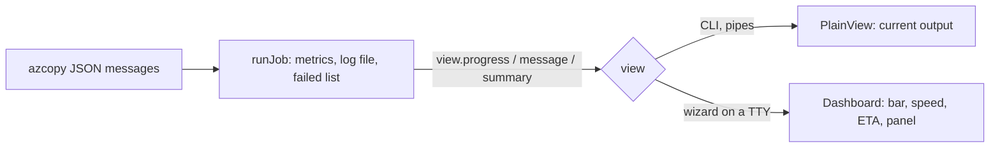

# Fancy live copy progress for the terminal UI

When the wizard starts a copy, retry or resume, the screen switches to the old output: a single `COPYING | discovered … | copied … ` line and a `================ Copy summary ================` block. It does not match the rest of the wizard and cuts off on narrow terminals. After this work the wizard shows a live dashboard in the same style as its prompts, and a result panel at the end. `copy` / `retry` / `resume` on the plain CLI, pipes and non-terminals keep the current output.

## What the user sees

Wide terminal (>= 80 columns), while copying:

```text
◇  Copying  amzn-s3-bucket-to-migrate → files3
│
│  ⠹ Copying                                              elapsed 2m 14s
│  ████████████████████░░░░░░░░░░░░░░░░░  58.3%   2.13 TiB / 3.65 TiB
│  speed 412 MiB/s  ▂▃▅▆▇▇▆▇   ETA 1h 12m
│  ✔ copied 1,204    ↷ ignored 15,000    ✖ failed 2    found 16,206
│  last failure  data/2024/big file.bin
│  log  runs\20261020T014500Z-full\copy-20261020T014500Z.log
```

While azcopy is still listing the source (totals keep growing) the bar is animated and says `Scanning source, totals still growing`; no ETA is shown until the scan ends.

Narrow terminal (< 60 columns) drops the sparkline, the log path and the last failure:

```text
⠹ Copying      2m 14s
███████░░░░░ 58.3%
412 MiB/s · ETA 1h 12m
✔ 1,204 ↷ 15,000 ✖ 2
```

Very narrow (< 36 columns): `58.3% 412MiB/s 1h12m`.

At the end, the dashboard is replaced by a result panel:

```text
◆  Completed with failed files
│  copied 1,204 · ignored 15,000 · failed 2
│  data 2.13 TiB in 2h 41m (average 235 MiB/s)
│  failed list  runs\…\failed-20261020T041200Z.jsonl
│  next         choose "Retry failed files" in the menu
└  Finished with exit code 1.
```

Green for success, yellow for failures or an interrupt, red for a failed job. Colours follow `NO_COLOR` / `FORCE_COLOR`, and the unicode symbols fall back to ASCII (`*`, `x`, `-`) when the terminal is not UTF-8.

## What changes

### A view between the job runner and the screen

`src/job.js` now talks to the console directly through the private `Screen` class. That class becomes a small interface that the job calls, so a second implementation can be plugged in:

```js
// src/view.js  (the current Screen, moved and renamed; behaviour unchanged)
export class PlainView {
  constructor(out) {}
  start({ logFile })             // prints "Copy log: ..."
  jobStarted(jobId)              // prints "Job ID: ..."
  progress(snapshot)             // redraws the one-line status (TTY) / periodic line (non-TTY)
  message(level, text)           // warnings and errors, printed above the status
  failure(relativePath)          // no-op in the plain view
  summary(report, hints)         // the existing "Copy summary" lines
}
```

`runJob({ …, view = new PlainView(out) })` calls these instead of `screen.print` / `screen.status`. The log file, `run.json`, failed list and exit codes are produced exactly as today and independent of the view, so nothing about retry / resume / delta changes.

`commands.js`: `execute()` passes `opts.view` to `runJob`; when a view is given, the `Source: / Target: / Mode:` preamble is not printed (the wizard has already shown the same facts in its summary).

### The dashboard

`src/ui/dashboard.js` implements the same interface:

- `renderDashboard(state, { columns, color, unicode })` is a pure function returning the lines for the current layout (wide, narrow, very narrow, scanning, finished). Every line is cut with the existing `fit()` so it never wraps, which keeps the cursor arithmetic exact.
- `Dashboard` keeps the last snapshot, a short speed history for the sparkline, and redraws the block in place: move the cursor up by the number of lines drawn, erase down, write the new lines. All of it goes out in one write through `coalescedOutput` (`src/ui/output.js`, the flicker fix), cursor hidden while running and shown again on every exit path.
- A 250 ms timer animates the spinner and the elapsed clock between azcopy's progress messages (azcopy reports about every 2 s). The timer is cleared in `finally`.
- Warnings, errors and the Ctrl+C notice go through `message()`: the block is erased, the line is printed in colour, the block is redrawn below it.
- `process.stdout` `resize` re-renders with the new width.
- `src/ui/style.js`: tiny helper for colour (`green`, `yellow`, `red`, `dim`, `bold`, `cyan`) and symbols, no dependency, honouring `NO_COLOR`, `FORCE_COLOR` and `isTTY`.



### Wiring in the wizard

`src/ui/wizard.js` creates `new Dashboard({ out, columns })` when `out.isTTY` and sets `opts.view` before calling `copyCommand` / `retryCommand` / `resumeCommand`. Without a TTY (tests, pipes) it passes nothing and the plain view is used. The final `prompts.outro` keeps the exit-code line.

## Steps

- [ ] 1. `src/view.js`: move `Screen` out of `job.js` as `PlainView` with the interface above; `runJob` takes `view` and uses it for every console line, including the final summary lines. Existing tests must pass unchanged.
- [ ] 2. `src/commands.js`: pass `opts.view` to `runJob`; skip the preamble when a view is given.
- [ ] 3. `src/ui/style.js`: colour and symbol helpers (NO_COLOR, FORCE_COLOR, ASCII fallback).
- [ ] 4. `src/ui/dashboard.js`: `renderDashboard` (pure) and `Dashboard` (in-place redraw, timer, resize, message lines, result panel, cleanup).
- [ ] 5. `src/ui/wizard.js`: create the dashboard on a TTY and pass it as `opts.view`.
- [ ] 6. Tests in `test/ui.test.js` and `test/copy.test.js` (see below).
- [ ] 7. `README.md`: "Terminal UI" section shows the dashboard and says that plain CLI output is unchanged.

## How it is verified

- [ ] `npm test` passes: all existing tests plus the new ones.
- [ ] `renderDashboard` tests at 120, 60 and 30 columns: no line is wider than the terminal, the percentage, counters, ETA and failure count appear in the right layouts, the scanning state shows no ETA, colours are absent with `color: false`.
- [ ] `Dashboard` tests with a fake stream: each update is exactly one write, it starts with the cursor-up/erase sequence for the previously drawn height, `message()` prints above the block, `finish()` shows the cursor and leaves the result panel, timers are cleared.
- [ ] Integration test: a copy through the fake azcopy with a `Dashboard` view writes the same `copy-*.log`, `failed-*.jsonl` and `run.json` as with the plain view, with no secret (`SECRETSIG123`, AWS secret) in the output or run directory.
- [ ] Manual, real terminal on Windows (Windows Terminal at 120 and 50 columns, `NO_COLOR=1`): List and a delta copy against `amzn-s3-bucket-to-migrate` through `node bin/azcopy-commander.js ui`; a forced Ctrl+C mid-run shows the interrupt notice and the resume hint; resizing the window mid-run redraws without garbage.
- [ ] `node bin/azcopy-commander.js copy …` in a terminal and piped to a file still print the old output.

## Decisions

| Decision | Choice | Why |
| --- | --- | --- |
| Where the dashboard is used | Only when the wizard runs on a TTY | The plain CLI stays script and log friendly; it can adopt the dashboard later with a `--ui` style flag |
| Rendering | Own small renderer on `coalescedOutput`, no new dependency | Clack has no progress-bar widget for a multi-line live block; it already needs the flicker fix |
| Seam | `view` object passed to `runJob`; `PlainView` is the old behaviour | Smallest change; logging, failed list and exit codes stay in one place |
| Redraw rate | On azcopy progress (about every 2 s) plus a 250 ms tick for spinner and clock | The screen feels alive without extra azcopy calls |
| Sparkline | Last 8 speed samples, wide layout only | Cheap and shows stalls at a glance |
| Final result | Panel with next-step hint, wizard keeps its `outro` exit code line | Gives the same information as the old summary in the wizard's style |

## Risks

- **Resizing mid-run**: the terminal re-wraps the lines already drawn, so the cursor-up count can be off and leave a few stale lines. Mitigation: lines are never wider than the terminal when drawn, and on `resize` the block is re-drawn after erasing; a stray line is possible on a very fast narrowing.
- **Terminals without ANSI cursor control** (very old consoles): the `isTTY` check falls back to the plain view; there is no further detection.
- **Hidden cursor left behind** if the process is killed hard: the dashboard shows the cursor in `finally` and on `SIGINT`/`exit`.

## Out of scope

- A full-screen takeover, mouse or key controls during a copy (pause, cancel button).
- Changing azcopy flags, the metrics maths, log files or exit codes.
- Making the dashboard the default for the plain CLI.
