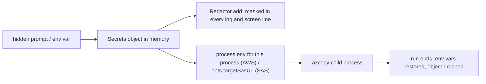

# Interactive terminal UI (wizard) for azcopy-commander

Today every run needs a long command line and secrets in environment variables. After this work, `azcopy-commander ui` (or just `azcopy-commander` in a terminal) walks the user through the run: pick an action (full copy, delta copy, list, retry, resume), enter the bucket, enter or reuse the AWS keys and SAS URL, pick an earlier run where one is needed, confirm, and watch the existing live progress. Secrets live only in process memory; nothing new is written to disk or logs.

The CLI itself stays dependency-free: `@clack/prompts` (v1.8.1, MIT, Node >= 20.12, signed with provenance) is loaded lazily, only by the `ui` command.

## What the user sees

```text
┌  azcopy-commander · S3 → Azure Blob
│
◆  What do you want to do?
│  ● Full copy  ○ Delta copy  ○ List  ○ Retry failed files  ○ Resume a run  ○ Quit
│
◇  AWS_ACCESS_KEY_ID / AWS_SECRET_ACCESS_KEY found in the environment
│  ● Use them   ○ Enter other credentials
│
◆  Target SAS URL (hidden)
│  ▪▪▪▪▪▪▪▪▪▪▪▪▪▪▪▪▪▪▪▪▪▪
│
◆  Delta since which run?
│  ● 2026-10-19 02:48  delta  success   1 copied · amzn-s3-bucket-to-migrate
│  ○ 2026-10-19 02:49  full   success   0 copied · amzn-s3-bucket-to-migrate
│  ○ 2026-10-18 21:03  full   partial  41 failed · amzn-s3-bucket-to-migrate
│  ○ Enter a date instead
│
◇  Summary
│  Source   https://s3.ap-southeast-2.amazonaws.com/amzn-s3-bucket-to-migrate
│  Target   https://acct.blob.core.windows.net/files3
│  Mode     delta, objects modified on/after 2026-10-19T02:38:30Z
│  Secrets  AWS key: environment · AWS secret: environment · SAS: typed (memory only)
│
◆  Start the copy?  Yes
└
```

Steps for the wizard:

1. **Action**: Full copy, Delta copy, List, Retry, Resume, Quit.
2. **AWS credentials** (every action needs them): if `AWS_ACCESS_KEY_ID` and `AWS_SECRET_ACCESS_KEY` exist, offer *Use them* or *Enter other credentials*; otherwise ask with hidden input. Optional `AWS_SESSION_TOKEN` is asked only when typing credentials.
3. **SAS URL**: same pattern for `AZCOPY_COMMANDER_TARGET_SAS_URL`. Validated live with `parseTargetSasUrl` (must be a container URL with a signature); its warnings (e.g. expires soon) are shown, the signature never is.
4. **Pick a previous run** (Delta copy, Retry, Resume): a list of all earlier runs in the output directory, newest first. Each line shows start time, kind, outcome, copied / failed counts and the bucket. The table shows which runs each action lists and what selecting one does:

   | Action | Runs listed | On selection |
   | --- | --- | --- |
   | Delta copy | runs that listed the bucket (outcome success or partial) | copies objects modified on/after that run's start minus 10 minutes (the same overlap as `--last-copy-date auto`); source settings prefilled from the run. A last item, *Enter a date instead*, covers any other date. |
   | Retry | runs with failed files | re-copies those files (`retryCommand`) |
   | Resume | runs that did not succeed and have an azcopy job | continues that job (`resumeCommand`) |

   If no run applies (for example no failed files anywhere) the wizard says so and returns to the menu.
5. **Source** (Full copy / Delta copy / List): bucket **name or ARN**, optional prefix, optional region (validated like `--source-region`), and `--overwrite-modified` (default No). For a delta copy these are prefilled from the run chosen in step 4 and can be edited.
6. **Summary and confirm**, then the existing command runs unchanged, with its live progress line and summary printed below the wizard.

## What changes

### Bucket name or ARN

`src/urls.js` gets `parseBucketInput(text)`; `buildSourceUrl` is unchanged. Accepted forms:

```js
parseBucketInput('my-bucket')                         // { bucket: 'my-bucket', prefix: '' }
parseBucketInput('arn:aws:s3:::my-bucket')            // { bucket: 'my-bucket', prefix: '' }
parseBucketInput('arn:aws:s3:::my-bucket/data/2024')  // { bucket: 'my-bucket', prefix: 'data/2024' }
parseBucketInput('arn:aws:s3:us-east-1:123:accesspoint/x') // UsageError: access point ARNs are not supported
```

`--source-bucket` on the CLI also accepts an ARN through the same function, so both entry points behave alike. An ARN prefix is combined with a typed prefix only if the typed one is empty; otherwise the wizard asks which to keep.

### Listing previous runs

`src/commands.js` exports `listRuns(opts)`, built on the same scan as `latestRunDir`: every `<timestamp>-…` folder that has a `run.json` in the output directory, newest first.

```js
listRuns({ outputDir: 'runs' });
// [{ dir, kind: 'delta', startedAt, outcome: 'success', copied: 1, failed: 0,
//    jobId, bucket, prefix, region: 'ap-southeast-2', targetBase, overwriteModified }, ...]
```

`region` is read from `sourceBase` (`s3.<region>.amazonaws.com`; none for the global endpoint). The wizard filters the list per action as in the table above. `deltaDateFor(run)` returns the run's `startedAt` minus the existing `AUTO_OVERLAP_MS`. If the run's `targetBase` differs from the SAS URL entered, the wizard shows a warning and asks to confirm before a delta copy; `retryCommand` / `resumeCommand` already refuse a mismatching target.

### The `ui` command

New files:

- `src/ui/wizard.js`: the flow above as `runWizard({ prompts, env, out })`. `prompts` is the `@clack/prompts` module passed in, so tests drive the flow with a scripted fake.
- `src/ui/secrets.js`: `Secrets` holds the typed values in memory and exposes `apply()` / `restore()`.
- `src/ui/index.js`: lazy `await import('@clack/prompts')`; on `ERR_MODULE_NOT_FOUND` prints "run `npm install` to use the UI" and exits 64.
- `bin/azcopy-commander.js`: new `ui` command; with no command on a TTY it starts the UI, otherwise it prints help as today. Without a TTY, `ui` refuses.

### Keeping secrets in memory only



- There is no `--aws-secret` / `--sas` flag and nothing is added to `argv`, `run.json`, `state.json`, the copy log or `failed-*.jsonl`. The commands already store only `targetBase` (no query) and run everything through `Redactor`.
- Typed AWS values are set on `process.env` for the run (that is how `execute()` and the azcopy child already read them) and restored to their previous values in a `finally`.
- Prompts use `password()` (masked with `▪`), and the summary says *environment* or *typed*, never any characters of a secret.
- The wizard never offers to "remember" or save credentials.

### Fancy and responsive

`@clack/prompts` is line-based, so it adapts to any width and height without a full-screen redraw. To be safe on narrow terminals:

- Summary values and run-list lines (URLs, paths, bucket names) are middle-ellipsised to `process.stdout.columns - 6` by a small `fit()` helper.
- Colour comes from clack (respects `NO_COLOR` and non-colour terminals); plain-ASCII fallback is clack's own.
- Ctrl+C at any prompt (`isCancel`) ends cleanly with "Cancelled", exit code 130. During a run, Ctrl+C keeps the existing stop-and-resume behaviour of `job.js`.

## Steps

- [ ] 1. `src/urls.js`: add `parseBucketInput` (name, `arn:aws:s3:::bucket[/prefix]`, reject other ARNs); use it in `copyCommand` / `listCommand` for `--source-bucket`. Unit tests.
- [ ] 2. `src/commands.js`: export `listRuns(opts)` and `deltaDateFor(run)` (see above), reusing the `latestRunDir` scan. Unit tests with fabricated run directories.
- [ ] 3. `package.json`: add `"dependencies": { "@clack/prompts": "^1.8.1" }`, `engines.node` `>=20.12`, run `npm install` to create `package-lock.json`; keep `node_modules/` ignored.
- [ ] 4. `src/ui/secrets.js`: `Secrets` with `apply()` / `restore()` of AWS env vars, registration with `Redactor`.
- [ ] 5. `src/ui/wizard.js`: the flow, including the run picker for delta / retry / resume, building the same `opts` object the CLI builds and calling `copyCommand` (with `lastCopyDate` for delta) / `listCommand` / `retryCommand` / `resumeCommand` (with `run`).
- [ ] 6. `src/ui/index.js` and `bin/azcopy-commander.js`: `ui` command, no-argument start on a TTY, TTY check, lazy import with a friendly error, `--help` text.
- [ ] 7. `test/ui.test.js`: scripted fake prompts; see verification.
- [ ] 8. `README.md`: a "Terminal UI" section (how to start, what is asked, how secrets are handled, Node version note).

## How it is verified

- [ ] `npm test` passes: existing 13 tests plus the new ones.
- [ ] `parseBucketInput` tests: name, ARN, ARN with prefix, access-point ARN rejected, invalid name rejected.
- [ ] `listRuns` / `deltaDateFor` tests: newest first, region and counts read from `run.json`, runs without `run.json` ignored.
- [ ] Wizard test with fake prompts and fake azcopy: a full Copy flow with typed secrets (`AKIA…`, secret, SAS with `sig=SECRETSIG123`). Assert that the opts passed to `copyCommand` are correct, all captured output and every file in the run directory contain none of the secrets, and `process.env` is restored afterwards.
- [ ] Wizard tests: secrets taken from the environment ("Use them") do not trigger a password prompt; Cancel (symbol) at each step exits 130 and runs nothing.
- [ ] Wizard tests with several fabricated runs: *Delta copy* picking an older run passes `lastCopyDate` = that run's start minus 10 minutes and prefilled bucket / prefix / region; *Enter a date instead* works; *Retry* lists only runs with failed files and passes the chosen `run`; *Resume* lists only unfinished runs with a job; an empty list returns to the menu.
- [ ] Manual in a real terminal on Windows (Windows Terminal at 120 and 50 columns, and `NO_COLOR=1`): run `node bin/azcopy-commander.js ui`, go through List and a delta copy against `amzn-s3-bucket-to-migrate`, check masking and that long paths are ellipsised.
- [ ] `copy` / `retry` / `resume` still work with no `node_modules` present (the UI import is lazy), and `ui` without a terminal refuses with exit 64.

## Decisions

| Decision | Choice | Why |
| --- | --- | --- |
| Library | `@clack/prompts` wizard (your choice) | Small, modern look, hidden input, line-based so any screen size works |
| Dependency loading | Lazy `import()` only in `ui` | Core copy/retry/resume stay dependency-free |
| How typed AWS keys reach azcopy | Set on `process.env` for the run, restored afterwards | That is how the code and azcopy already read them; no change to the job runner |
| How the SAS reaches azcopy | `opts.targetSasUrl` in memory | Already supported by the commands |
| Start | `ui` command, and no command on a TTY | Explicit and convenient; scripts without a TTY still get help |
| Delta, Retry, Resume selection | Pick any previous run from a list, not only the latest; delta baseline = chosen run's start minus 10 min | Matches your request; same overlap as `--last-copy-date auto`; the CLI's `--run` / latest-run behaviour is unchanged |
| Delta as its own menu action | Yes, next to Full copy | Matches your request; a delta can also use *Enter a date instead* |
| Meaning of "rerun" | Assumed to mean *resume* | Retry already re-copies failed files; tell me if you meant something else |
| Runs shown | Filtered to those the action can use | A delta from a run that never listed the bucket, or a retry with no failures, would do nothing useful |
| ARN support | Bucket and object ARNs only | Access-point and multi-region ARNs would need different azcopy URLs |

## Risks

- **No live dashboard.** Clack is a prompt flow; while a copy runs the user sees the existing single live status line, not panels. Ink would give a persistent dashboard, at the cost of a larger dependency tree and Node 22.
- **Run list depends on the output directory.** Only runs under the chosen `--output-dir` (default `./runs`) are listed; the wizard shows which directory it is reading.
- **azcopy receives the SAS in its command line** (existing behaviour); it is visible to other local users in the process list while azcopy runs. The wizard does not change that.
- **The azcopy child inherits typed AWS keys through its environment**, as with env-var use today.
- A compromised npm release is the cost of any dependency; mitigated by pinning through `package-lock.json` and the package's signed provenance.

## Out of scope

- Saving credentials, profiles or "remember me".
- A full-screen dashboard, mouse support, theming options.
- Access-point ARNs, non-AWS S3 endpoints, AWS SSO / profile lookups.
- Any change to azcopy flags or copy semantics.
