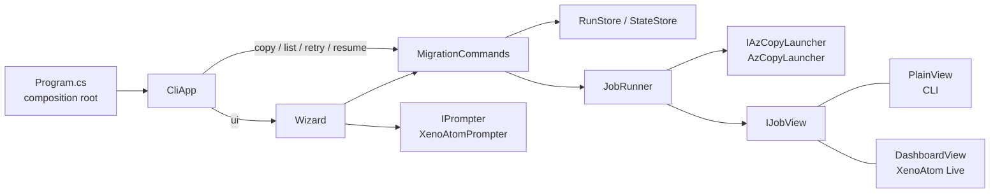
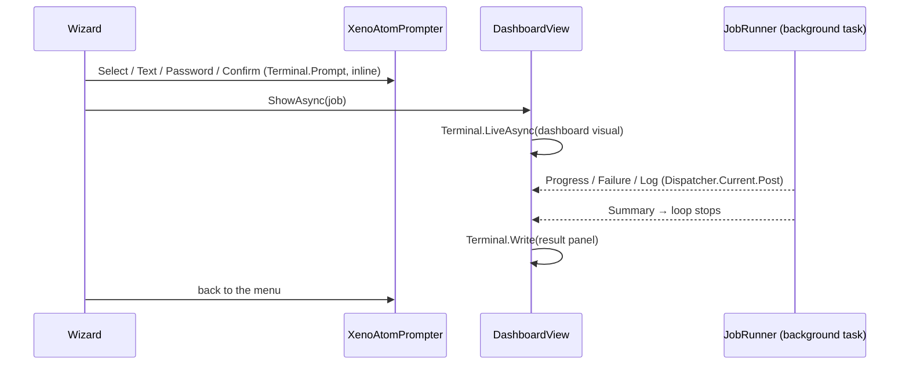

# Port azcopy-commander to C# .NET 10

Today azcopy-commander is a Node.js app. Its terminal UI uses `@clack/prompts`, and the dashboard is drawn by hand with ANSI codes, cursor arithmetic and a flicker workaround (`output.js`, `style.js`, `dashboard.js`). After this port it is a .NET 10 console app, `azcopy-commander.exe`. It has the same commands (`copy`, `list`, `retry`, `resume`, `ui`), the same options, help and exit codes (0/1/2/64/130), and the same files: `run.json`, `state.json`, `failed-*.jsonl` and copy logs. **Existing `runs/` folders keep working with `retry`, `resume` and `--last-copy-date auto`.** The wizard and the live dashboard are rebuilt with [XenoAtom.Terminal.UI](https://github.com/XenoAtom/XenoAtom.Terminal.UI/). That removes the hand-written rendering code.

## What changes

### Solution layout

There is one app project and one test project. Folders follow the modules of today's code, so each JS file has an obvious C# home.

```text
AzCopyCommander.slnx
Directory.Build.props                 net10.0, Nullable, ImplicitUsings, warnings as errors
src/AzCopyCommander/
  Program.cs                          composition root: parse args → build services → dispatch
  Cli/      CliArguments.cs, HelpText.cs, CliApp.cs
  Core/     Format.cs, Dates.cs, SourceUrls.cs, TargetSas.cs, Redactor.cs, UsageException.cs
  AzCopy/   IAzCopyLauncher.cs, AzCopyLauncher.cs, AzCopyMessage.cs, JobSummary.cs
  Runs/     RunManifest.cs, RunStore.cs, StateStore.cs, JsonContext.cs
  Jobs/     JobRunner.cs, JobReport.cs, Metrics.cs, IJobView.cs, PlainView.cs, SummaryLines.cs, ExitCodes.cs
  Commands/ IMigrationCommands.cs, MigrationCommands.cs, CommandOptions.cs, AzCopyArgs.cs
  Ui/       IPrompter.cs, XenoAtomPrompter.cs, Wizard.cs, Secrets.cs,
            DashboardModel.cs, DashboardView.cs, ResultPanel.cs
tests/AzCopyCommander.Tests/          xUnit v3; FakeAzCopy, FakePrompter
```

Packages: `XenoAtom.Terminal.UI` 3.10.0 (BSD-2, net10.0 only, version pinned), `Microsoft.Extensions.DependencyInjection`, and for the tests `xunit.v3`. Nothing else is added.

### Abstractions only at the seams, one composition root

Four interfaces exist because a second implementation exists or a test needs a fake. Everything else is a concrete class registered as itself. The clock is .NET's own `TimeProvider`, not a custom interface.

| Interface | Real implementation | Second implementation |
| --- | --- | --- |
| `IAzCopyLauncher` | `AzCopyLauncher`, which starts the process and reads JSON lines | `FakeAzCopy` in the tests, which replays azcopy's message protocol in process |
| `IJobView` | `PlainView`, the console line and summary used by the CLI | `DashboardView`, the XenoAtom live dashboard used by the wizard |
| `IPrompter` | `XenoAtomPrompter` | `FakePrompter`, scripted answers (as `fakePrompts` in `ui.test.js` today) |
| `IMigrationCommands` | `MigrationCommands`: copy, list, retry, resume | a spy in the wizard tests |

`Program.cs` parses the arguments first, because `--output-dir`, `--azcopy-path` and the other options shared by all commands configure the services. It then builds the container and hands over to `CliApp`:

```csharp
// Program.cs (sketch)
var parsed = CliArguments.Parse(args);
if (parsed.Error is not null) { Console.Error.Write($"{parsed.Error}\n\n{HelpText.Text}"); return ExitCodes.Usage; }

using var services = new ServiceCollection()
    .AddSingleton(parsed.Global)                       // output dir, plan dir, azcopy path/args, dry run
    .AddSingleton(TimeProvider.System)
    .AddSingleton(ConsoleIO.System)                    // In, Out, Err, IsInteractive
    .AddSingleton<IAzCopyLauncher, AzCopyLauncher>()
    .AddSingleton<RunStore>().AddSingleton<StateStore>()
    .AddSingleton<JobRunner>()
    .AddSingleton<IMigrationCommands, MigrationCommands>()
    .AddSingleton<IPrompter, XenoAtomPrompter>()
    .AddSingleton<Wizard>()
    .AddSingleton<CliApp>()
    .BuildServiceProvider();

return await services.GetRequiredService<CliApp>().RunAsync(parsed);
```



### The core port, behaviour unchanged

Each module keeps its logic and its doc comments, moved to idiomatic C#:

- **Records instead of object spreads.** `RunManifest`, `JobReport` and `MetricsSnapshot` are records. Retry builds its manifest with `previous with { Kind = "retry", ... }`.
- **Files stay byte-compatible.** `System.Text.Json` uses a source-generated `JsonContext`: camelCase, indented, nulls written. Timestamps are written as `2026-10-22T00:46:13.471Z`, as JS `toISOString()` does, so a test reads the real `run.json` and `state.json` shapes found in `runs/`.
- **Same URLs, same state keys.** JS `encodeURIComponent` leaves `!'()*` unescaped and `Uri.EscapeDataString` does not. A small `EncodeUriComponent` helper keeps the URLs, and the `state.json` keys derived from them, identical.
- **Invariant culture everywhere.** `1,204` and `2.13 TiB` look the same on any machine.
- **Cancellation replaces `process.on('SIGINT')`.** `JobRunner.RunAsync(..., CancellationToken)` treats cancellation as an interrupt. It stops azcopy, records the outcome `interrupted` and returns exit code 130. The CLI cancels the token from `Console.CancelKeyPress`; the dashboard cancels it on Ctrl+C. Stopping azcopy sends `SIGINT` on Linux and macOS (P/Invoke `kill`) and calls `Process.Kill()` on Windows, which is what Node's `child.kill('SIGINT')` does there today. The job plan stays on disk, so `resume` still works.
- **No hand-written parser library.** `CliArguments` is a small parser (about 70 lines) for the flat option set, and `HelpText` keeps today's help text word for word.

```csharp
public interface IAzCopyLauncher
{
    /// Starts azcopy; stdin is closed so it can never wait on a prompt. Never throws for a missing binary:
    /// the result carries StartError instead.
    IAzCopyProcess Start(AzCopyCommand command, IReadOnlyList<string> args,
                         IReadOnlyDictionary<string, string?> environment,
                         Action<AzCopyMessage> onMessage, Action<string> onStderr);
}

public interface IJobView
{
    void Start(string logFile);
    void JobStarted(string jobId);
    void Progress(MetricsSnapshot snapshot, bool periodic);
    void Message(LogLevel level, string text);          // warnings / errors, already redacted
    void Failure(string relativePath, string? errorCode);
    void Log(string level, string text);                // Info / stderr lines, already redacted
    void Summary(JobReport report, RunHints hints);
}
```

### Secrets: no more environment mutation

Today the wizard writes typed AWS keys into `process.env` and restores them afterwards. In .NET, credentials become an explicit `AwsCredentials` value in `CommandOptions`. `AzCopyLauncher` puts it into the child's `ProcessStartInfo.Environment` only. The CLI path fills it from `AWS_ACCESS_KEY_ID`, `AWS_SECRET_ACCESS_KEY` and `AWS_SESSION_TOKEN`. The wizard fills it from the environment or from the typed values. Nothing about secrets is written to disk, to argv or to a log, and the `Redactor` rules are unchanged. `Secrets` shrinks to holding the wizard's choices and describing where each value came from.

### Terminal UI with XenoAtom

The flow stays **inline**, as today: prompts scroll up the terminal, the dashboard updates in place below them, and the result panel stays in the scrollback.



- **`XenoAtomPrompter`** implements `IPrompter` with `Terminal.Prompt(new SelectionPrompt<T>(...))`, `Terminal.Ask(..., p => p.Validate(...).Default(...))` and `ConfirmationPrompt`. The validators are the same domain checks: `TargetSas.Parse`, `SourceUrls.ParseBucketInput`, `Dates.ParseLastCopyDate`. Esc and Ctrl+C surface as `OperationCanceledException`, which ends the wizard with exit code 130. XenoAtom has no password prompt, so `Password` is a small `Terminal.Live` around `new TextBox().IsPassword(true).ClipboardMode(Disabled)` that ends on Enter (see step 1).
- **`DashboardModel`** holds the dashboard's state, free of any UI type: snapshot, last 8 speeds, last 3 failures with codes, error-code counts and the last 50 azcopy lines. Its rules are tested like today's `renderDashboard` tests.
- **`DashboardView`** implements `IJobView`. Its methods are called from the job's thread and `Post` to the XenoAtom dispatcher, which enforces thread affinity. The visual tree is a `VStack` that binds to the model: the title and route, a `Spinner` with elapsed time, a `ProgressBar` (or a "Scanning source, totals still growing" line while azcopy lists), speed with a text sparkline and ETA, the copied / ignored / failed / found counters, the last 3 failures (error code first), the log path, and a `LogControl` "azcopy output" pane (`MaxCapacity` 50, up to 10 rows high). `Message` writes above the live region with `Terminal.WriteLine`.
- **`ResultPanel`** builds the final `Group`, coloured by outcome (success green, partial or interrupted yellow, failed red), with the top error codes, the failed list, the next step and the log.
- **Deleted, with no replacement:** coalesced output and DEC 2026 sync, cursor-erase arithmetic, the `NO_COLOR`/`FORCE_COLOR`/unicode detection and the hand-made narrow layouts. XenoAtom does diff rendering and terminal capability detection itself. Narrow terminals get XenoAtom's own wrapping and clipping instead of the 36/60-column layouts.

```csharp
public interface IPrompter
{
    void Intro(string title);
    void Outro(string message);
    void Info(string message); void Warn(string message); void Error(string message);
    void Note(string title, IReadOnlyList<string> lines);
    T Select<T>(string message, IReadOnlyList<Choice<T>> choices);
    string Text(string message, string? initial = null, Func<string, string?>? validate = null);
    string Password(string message, Func<string, string?>? validate = null);
    bool Confirm(string message, bool initial);
}
```

### What is removed from the repo

`package.json`, `package-lock.json`, `bin/azcopy-commander.js`, `src/**/*.js` and `test/**/*.js`. The `.ps1` scripts call `dotnet run --project src/AzCopyCommander --` instead of `node bin/azcopy-commander.js`. The README is updated: requirements, usage commands, the terminal UI section (no `npm install`), Development (`dotnet test`) and the verification notes. `.gitignore` gets `bin/` and `obj/`, and loses `node_modules/`.

## Steps

- [x] 1. **XenoAtom spike** (a throwaway console project outside the repo). Confirm: a password `TextBox` in `Terminal.Live` ends on Enter and cancels on Esc and Ctrl+C; `Terminal.Prompt` → `Terminal.LiveAsync` → `Terminal.Write` run one after another; Ctrl+C during `LiveAsync` reaches a key handler; output written with `Terminal.WriteLine` appears above the live region; `NO_COLOR` is respected. Adjust the UI part of this plan if something does not hold.
- [x] 2. Scaffold `AzCopyCommander.slnx`, `Directory.Build.props`, `src/AzCopyCommander` (`AssemblyName` `azcopy-commander`) and `tests/AzCopyCommander.Tests`; check that `dotnet build` passes.
- [x] 3. `Core/`: `Format`, `Dates`, `SourceUrls` (including `EncodeUriComponent`), `TargetSas`, `Redactor`, `UsageException`, with the unit tests ported from `copy.test.js`.
- [x] 4. `AzCopy/`: `AzCopyMessage.Parse` (nested JSON content, counters sent as strings), `JobSummary`, `AzCopyLauncher` (line reading, stdin closed, start error, interrupt), and `Jobs/Metrics`, with their tests. Test the launcher once against a real process (`dotnet --version`) and once against a missing binary.
- [x] 5. `Runs/`: `RunManifest`, `JsonContext`, `RunStore` (read/write `run.json`, latest run, `ListRuns`, `DeltaDateFor`) and `StateStore` (atomic write + rename). Add a compatibility test that round-trips the `run.json` and `state.json` shapes found in `runs/`.
- [x] 6. `Jobs/`: `JobRunner` (log, failed list, `jobs show` safety net, outcome mapping, cancellation), `JobReport`, `PlainView`, `SummaryLines`, `ExitCodes`. Add `FakeAzCopy` (the scenarios of `test/fixtures/fake-azcopy.js`) and port the job tests.
- [x] 7. `Commands/`: `MigrationCommands` (copy, list, retry, resume), `CommandOptions`, `AzCopyArgs`. Port the end-to-end tests: copy → delta(auto) → retry, confirm the latest run (`ConsoleIO.In` is a `StringReader`), `--overwrite-modified`, nothing to copy, usage errors, dry run, list, ARN, and no secret in the files.
- [x] 8. `Cli/` + `Program.cs`: `CliArguments`, `HelpText`, `CliApp`, the composition root and the `Console.CancelKeyPress` → token wiring. Test that arguments map to options and that a parse error gives exit code 64 with the help.
- [x] 9. `Ui/` prompts: `IPrompter`, `XenoAtomPrompter`, `Secrets`, `Wizard`. Port the wizard tests from `ui.test.js` with `FakePrompter` and a spy `IMigrationCommands`: options passed, environment versus typed secrets, ARN prefix conflict, cancel at every step, decline, delta/retry/resume run lists, target mismatch, usage error without secrets.
- [x] 10. `Ui/` dashboard: `DashboardModel`, `DashboardView`, `ResultPanel`. Add model tests (failures and codes, the azcopy output cap and sanitising, error-code ordering) and a render test: `Terminal.Write` of the dashboard and result visuals against XenoAtom's `InMemoryTerminalBackend` at 100 and 50 columns.
- [x] 11. Remove the Node files, update the `.ps1` scripts, `.gitignore` and `README.md`.

## How it is verified

- [x] `dotnet build -warnaserror` and `dotnet test` pass.
- [x] `dotnet run --project src/AzCopyCommander -- --help` prints the same help as today, and `copy` without `--source-bucket` exits with 64.
- [x] `copy --source-bucket <bucket> --source-region ap-southeast-2 --dry-run` prints the same redacted azcopy command line as the Node version.
- [x] `retry --run runs/<existing run> --dry-run` and `resume --run ... --dry-run` accept the run directories already in `runs/` (manifest compatibility).
- [ ] By hand in Windows Terminal: the wizard menu, hidden input, a SAS validation message while typing, Esc and Ctrl+C at a prompt (exit 130), and a real copy showing the dashboard and then the result panel. Repeat at a narrow width and with `NO_COLOR=1`.
- [ ] By hand: Ctrl+C during a dashboard copy gives outcome `interrupted` and exit 130, and `resume` then continues the job.

> [!NOTE]
> The two checks by hand need a real console and are left to the user. Deviations found while implementing:
> - **Prompts:** in XenoAtom 3.10.0, `SelectionPrompt<T>` throws inline ("only supported in fullscreen apps"), and `ConfirmationPrompt` cannot be confirmed with Enter. `XenoAtomPrompter` therefore builds select, confirm, text and password prompts on `Terminal.LiveAsync` (`OptionList<T>`, `TextBox`). Esc and Ctrl+C throw `OperationCanceledException`.
> - **Tests:** key-driven prompt tests turned out to be possible through `InMemoryTerminalBackend.PushEvent`, so they were added (`TerminalTests`).
> - **Dashboard updates:** the `IJobView` calls are queued and applied in the live loop's update callback, which a posted no-op wakes. They are not `Post`ed as state changes.

## Decisions

| Decision | Choice | Why |
| --- | --- | --- |
| Node code | Replaced in place and deleted in the same change | "Convert the application"; two implementations would drift |
| Data files | Byte-compatible `run.json`, `state.json` and `failed-*.jsonl` | Existing runs stay usable for retry, resume and delta |
| Dashboard hosting | Inline `Terminal.LiveAsync`, not fullscreen `Terminal.Run` | Prompts are inline-only in XenoAtom, and today's flow is inline too, with the result left in scrollback |
| DI | `Microsoft.Extensions.DependencyInjection` only, no Generic Host | The host adds logging, config and console lifetime handling that fight the terminal UI |
| Interfaces | Only `IAzCopyLauncher`, `IJobView`, `IPrompter`, `IMigrationCommands`, plus built-in `TimeProvider` | Each has two implementations or a test fake |
| CLI parsing | Small hand-written parser, not System.CommandLine | Flat option set; keeps the curated help text and exit code 64 exact |
| AWS credentials | Passed to the azcopy child's environment, not set in our process | Removes the apply/restore dance; same result for azcopy |
| Narrow layouts | Dropped in favour of XenoAtom's own wrapping and clipping | Removes most of the hand-written rendering code |
| Tests | xUnit v3, in-process `FakeAzCopy` instead of the Node fixture | No second runtime needed; the parser is tested on the same JSON lines |

## Risks

- **XenoAtom API churn.** It went from 1.0 to 3.0 between February and April 2026, and has a single maintainer. The version is pinned and all XenoAtom code stays in `XenoAtomPrompter`, `DashboardView` and `ResultPanel`.
- **Unconfirmed behaviour.** Password input, Ctrl+C inside a live region, and running prompt → live → write in sequence are not documented. Step 1 checks them before anything else is built.
- **Limited UI test coverage.** XenoAtom's interactive test driver is internal, so key-driven UI tests are not possible. Logic lives in `Wizard` and `DashboardModel`, which are tested without the UI, and the visuals get render tests. Interactive behaviour stays a manual check, as it is today.

## Out of scope

- New features, or any change to azcopy flags and copy semantics.
- Native AOT, single-file publishing, or packaging as a `dotnet tool`. The code stays AOT-friendly through source-generated JSON, but publishing is a separate step.
- Fullscreen mode, mouse support, or redesigning the wizard flow.

<details><summary>Alternatives ruled out</summary>

- **Generic Host (`Host.CreateApplicationBuilder`).** It brings logging, configuration and Ctrl+C lifetime handling that compete with XenoAtom's input. A plain `ServiceCollection` is enough for about ten services.
- **System.CommandLine.** It would generate its own help and parse-error output. Matching the current help text and exit code 64 needs more configuration than the small parser does.
- **An `IFileSystem` abstraction.** Today's tests use temporary directories, and that works just as well in .NET.
- **Fullscreen `Terminal.Run` dashboard.** It would need the prompts rebuilt as dialogs or forms, because XenoAtom prompts are inline-only. That is a larger redesign than a port.

</details>
