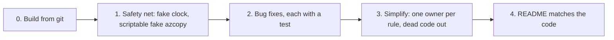

# Make azcopy-commander build from git, fix the bugs a review found, and remove what it does not need

The code is small, readable and mostly does what the README says. Its interfaces (`IAzCopyLauncher`, `IJobView`, `IPrompter`, `IMigrationCommands`) each have a real second implementation or a test fake, so the review found no layering for its own sake.

But the review found three kinds of problems:

- The branch cannot build from git.
- Five behaviours break promises the README makes.
- A few rules exist twice, once in the wizard and once in the commands, and the copies have drifted apart. That drift is what causes one of the bugs.

When the work is done:

- A clean clone builds, and the tests pin down the job outcome logic.
- Every README claim holds, or the README says what really happens.
- Each rule lives in one place.

File formats do not change: `run.json`, `state.json` and `failed-*.jsonl` stay byte-compatible with existing `runs/` folders.

> **State on 2026-10-23:** the four files of `src/AzCopyCommander/Runs/` have been copied back into this checkout from the `trusty-savanna-fstm` worktree, and they are identical to the worktree copies. They are still ignored by git and not committed: step 1 commits them.

## What changes

The work runs in four phases. Each phase leaves the tests green and can stop there.



### 0. The repository builds from git (blocker)

`.gitignore` line 1, `runs/`, also matches `src/AzCopyCommander/Runs/` because `core.ignorecase=true`. As a result `RunStore`, `StateStore`, `RunManifest` and `JsonContext` were never committed. The `dotnetify` checkout fails with 18 errors of type CS0234/CS0246. In the worktree that has the files, the build passes with 0 warnings and all 81 tests pass.

```gitignore
# before
runs/
# after: only the output folder at the repository root
/runs/
```

### 1. A test safety net before touching behaviour

The tests cover the copy flow from end to end, the wizard and the dashboard well. They do not cover the logic that decides how a job ended, because:

- `TimeProvider.System` is injected everywhere but never faked, which is why `CommandTests.cs:175` sleeps for 1.1 s.
- `FakeAzCopy` chooses its behaviour from a few boolean flags, so it cannot replay an arbitrary azcopy run.
- It also sends `TransferSize` as the string `"10"`. azcopy's `rpc-models.go` declares it as a `uint64`, so the real azcopy most likely sends a JSON number.

Two test-only changes fix this:

- A small hand-written `TimeProvider` subclass, with no new package.
- A `FakeAzCopy` that can replay a list of JSON lines for each call.

Every fix in phase 2 then comes with a test that fails before the fix.

### 2. Bug fixes

These are ordered by harm.

| # | What breaks | Where | Fix |
| --- | --- | --- | --- |
| B1 | `resume` cannot continue after a reboot, a crash or a second Ctrl+C (README line 31 promises this). `run.json` gets the azcopy job ID only *after* the job ends. | `MigrationCommands.ExecuteAsync`, `JobRunner` `Init` | Write `run.json` again as soon as azcopy reports its job ID. |
| B2 | A wizard delta copy based on a **retry** run uses the retry's start time. Objects modified between the original copy and the retry are skipped and never copied. | `Wizard.CanUse` (line 62) | Only `full` and `delta` runs can be the base of a delta copy, the same rule as `--last-copy-date auto`. |
| B3 | `list` ignores azcopy's exit code: if azcopy fails without a JSON `Error`, it prints "0 file(s)" and exits 0. `--dry-run` is also ignored, so `list` runs azcopy anyway. | `MigrationCommands.ListAsync` | A non-zero exit code becomes exit code 2; `--dry-run` prints the command and stops. |
| B4 | If an output callback throws (for example disk full while writing the failed list), nothing reads azcopy's stdout any more. azcopy then blocks on the full pipe and the tool hangs. | `AzCopyLauncher.Running.ReadLinesAsync` | Keep reading the output, stop azcopy, and report the error once azcopy has exited. |
| B5 | Parallel instances, which the README recommends ("one instance per `--source-prefix`"): two runs started in the same second share a run folder, and `state.json` updates can be lost. | `RunStore.NewRunDir`, `StateStore.Save` | Create the run folder exclusively, adding `-2`, `-3`, … when it exists. Update `state.json` under a lock file. |
| B6 | Smaller mismatches with the README: (a) `resume` of a run that succeeded exits 64, while `retry` with nothing to do exits 0, and only after asking for a SAS URL; (b) resuming an older run moves the `auto` date back; (c) "no transfers were scheduled" is printed as a red ERROR on a run that succeeded; (d) ARNs of the `aws-cn` partition and `bucket/*` are accepted but produce wrong URLs. | `MigrationCommands`, `StateStore`, `JobRunner`, `SourceUrls` | (a) Report "nothing to do" and exit 0 *before* asking for anything; (b) `state.json` only moves forward; (c) log it as INFO; (d) accept only `arn:aws:` and reject `*`. |

B1 is the important one. The job ID arrives in azcopy's first message, so `JobRunner` passes it on and the command saves it:

```csharp
// JobRequest gains one callback; ExecuteAsync supplies it.
public sealed record JobRequest(..., RunHints Hints, Action<string>? OnJobId = null);

// MigrationCommands.ExecuteAsync
var request = new JobRequest(..., OnJobId: id =>
    RunStore.WriteManifest(manifest with { Outcome = Outcomes.Running, JobId = id }));
```

### 3. Simplify: one owner per rule, dead code out

None of these steps changes behaviour. Each one removes a duplicate or an unused piece.

**Which runs an action can use is decided in two places.** `Wizard.CanUse` and the checks in `MigrationCommands.RetryAsync`/`ResumeAsync` have drifted apart, which is where B2 and B6a come from. The rule moves to `RunInfo`, the type both of them read:

```csharp
public sealed record RunInfo(...)
{
    public bool CanRetry => Failed > 0;
    public bool CanResume => !string.IsNullOrEmpty(JobId) && Outcome != Outcomes.Success;
    /// <summary>Same baseline as --last-copy-date auto: a copy run that completed.</summary>
    public bool IsDeltaBase => Kind is "full" or "delta" && !string.IsNullOrEmpty(Bucket)
                               && Outcome is Outcomes.Success or Outcomes.Partial;
}
```

**The `failed-*.jsonl` format is coded twice.** `JobRunner` writes it with `FailedRecord`. `RetryAsync` reads it back by hand with `JsonDocument` and `"relativePath"`. A new `Runs/FailedList.cs` owns both directions, and an empty `relativePath` is skipped.

**`IMigrationCommands.ListRuns()` is not a command.** It only forwards to `RunStore`. The wizard takes `RunStore` directly, and the interface keeps the four commands it is named for.

**`JobRunner.RunAsync` is one 175-line method.** The decision "azcopy status, interrupt, exit code, failure count → outcome" (lines 199-205) becomes a pure function. The phase 1 tests then cover each case of that table:

```csharp
internal static (string JobStatus, string Outcome) Decide(
    bool interrupted, string? endOfJobStatus, bool nothingToCopy, int? exitCode, long failed);
```

**Dead or duplicated code:**

- `AzCopyCommand.PrefixArgs` is always `[]`, in production and in the tests: remove it.
- `DashboardModel.CountersText` is used only by a test, and `DashboardView.CountersMarkup` builds the same text: keep one.
- `DashboardModel.Output` stores the same lines as the `LogControl` of `DashboardView`, and `DashboardView.Log` sanitizes each line twice: keep one store.
- `RunStore.LatestRunDir` lists the folders a second way. It becomes `ListRuns().FirstOrDefault()`, which also skips an unreadable `run.json` instead of crashing with exit 2.

**The `--azcopy-arg` flags that break the README's guarantees are rejected.** These flags come after the tool's own, so `--azcopy-arg=--overwrite=true` silently ends the "never overwritten" promise. The parser rejects `--overwrite`, `--from-to`, `--recursive`, `--as-subdir`, `--output-type`, `--include-after`, `--list-of-files` and `--dry-run`, with or without `=value`. `--log-level` stays allowed, as the README documents. The README says clearly what `--azcopy-arg` is for (tuning flags such as `--cap-mbps`, `--log-level`, `--block-size-mb`), which flags are refused, and the tool option to use instead:

```text
$ azcopy-commander copy --source-bucket b --azcopy-arg=--overwrite=true
Error: --azcopy-arg "--overwrite=true" is not allowed: the overwrite policy is set by azcopy-commander (use --overwrite-modified).
```

**The composition root becomes one plain method.** `Microsoft.Extensions.DependencyInjection` wires about 10 singletons in `Program.cs`, while `tests/AzCopyCommander.Tests/Harness.cs` wires the same graph again by hand. One method replaces both, and the package reference is removed from `AzCopyCommander.csproj`:

```csharp
// src/AzCopyCommander/Services.cs
internal static class Services
{
    /// <summary>The application's objects, wired once. Tests pass their own launcher, prompter and clock.</summary>
    public static CliApp Create(GlobalOptions global, ConsoleIO io, IAzCopyLauncher launcher, IPrompter prompter, TimeProvider time)
    {
        var runs = new RunStore(global);
        var commands = new MigrationCommands(global, io, runs, new StateStore(global), new JobRunner(launcher, time), launcher, time);
        return new CliApp(io, commands, new Wizard(prompter, commands, runs, global, io, time));
    }
}

// Program.cs
var app = Services.Create(parsed.Global, ConsoleIO.System, new AzCopyLauncher(), new XenoAtomPrompter(), TimeProvider.System);
return await app.RunAsync(parsed, interrupt.Token);
```

### 4. The README says what the code does

- The `state.json` key is the source URL (its endpoint included) together with the target URL (its prefix included). A different `--source-region` or prefix therefore has no `auto` history.
- On Windows an interrupt ends azcopy with `Process.Kill()`; a second Ctrl+C ends the tool at once.
- Exit code 2 also covers internal errors, such as a corrupt `state.json` or `run.json`.
- `retry-input.txt` is listed in the run folder table. The resume list is described as "runs that did not succeed", not "unfinished runs".
- The rules for dates: dates in the future are rejected, and `auto` is lower case only.
- `--azcopy-arg`: what it is for, the flags it refuses and why, and the tool option to use instead of each.
- Running several instances: one per `--source-prefix` is supported, also with the same `--output-dir`; run folders never collide, and `state.json` is updated under a lock.

## Steps

- [x] 1. Change `.gitignore` `runs/` to `/runs/` and commit it together with the four files already in `src/AzCopyCommander/Runs/`. Check that `git check-ignore src/AzCopyCommander/Runs/RunStore.cs` prints nothing and that `runs/` at the root is still ignored.
- [x] 1b. Add `Services.Create` (`src/AzCopyCommander/Services.cs`); `Program.cs` and `Harness.cs` use it; remove the `Microsoft.Extensions.DependencyInjection` package reference. Add a test that builds the app through `Services.Create` and runs `--help`.
- [x] 2. Tests: add a `FakeTimeProvider` (a `TimeProvider` subclass with `Advance`) to `Harness`; replace the 1.1 s sleep in `CommandTests.cs:175`; add a test for the 30 s STATS line.
- [x] 3. Tests: give `FakeAzCopy` a "replay these lines" mode and send `TransferSize` as a number. Check the full azcopy argument list and the `AZCOPY_LOG_LOCATION`/`AZCOPY_JOB_PLAN_LOCATION` environment variables for copy, list, retry and resume.
- [x] 4. B1: add `JobRequest.OnJobId`, call it from the `Init` case in `JobRunner`, and save it in `ExecuteAsync`. Test: the fake stops after `Init` with no `EndOfJob`, and `run.json` has the job ID.
- [x] 5. B2 and the run rules: add `CanRetry`, `CanResume` and `IsDeltaBase` to `RunInfo` (`Runs/RunStore.cs`); `Wizard.CanUse` and `MigrationCommands` use them. Test: a retry run is not offered as a delta base.
- [x] 6. B3: `ListAsync` fails on a non-zero exit code and honours `--dry-run`. Two tests.
- [x] 7. B4: `AzCopyLauncher` catches a handler exception, keeps reading the output, interrupts azcopy and then faults `Completion` with that exception; update the doc comment in `IAzCopyLauncher.cs`. Test with a real child process (`dotnet --version`) and a handler that throws.
- [x] 8. B5: `RunStore.NewRunDir` creates the folder and adds `-2`, `-3`, … when it exists, and the kind is parsed as the first word after the timestamp. `StateStore.Save` holds `state.json.lock` (opened with `FileShare.None`, short retry) around the read-modify-write.
- [x] 9. B6a–d. A test for each: "nothing to do" exits 0 before any question; `state.json` never moves back; "no transfers were scheduled" is not shown as an error; `arn:aws-cn:…` and `bucket/*` are rejected.
- [x] 10. `Runs/FailedList.cs` (write and read); `JobRunner` and `RetryAsync` use it.
- [x] 11. Remove `ListRuns` from `IMigrationCommands` and `SpyCommands`; `Wizard` takes `RunStore`.
- [x] 12. Extract `JobRunner.Decide(...)` and add a table test of its cases: StartError, a crash without `EndOfJob`, `Completed` with failures → partial, `CompletedWithSkipped`, interrupted, `NothingToCopy`, an unknown status.
- [x] 13. Remove `AzCopyCommand.PrefixArgs`, `DashboardModel.CountersText`, the duplicate output store and the double sanitize; base `LatestRunDir` on `ListRuns`.
- [x] 14. In `CliArguments.Parse`, reject the `--azcopy-arg` flags listed above (with or without `=value`), with a usage error that names the flag and the option to use instead. Tests for an allowed and a refused flag.
- [x] 15. Update `README.md` and `HelpText.cs` for phase 4, including a clear `--azcopy-arg` section and the parallel-run guidance.

## How it is verified

- [x] A fresh `git clone` of the branch into a temporary folder passes `dotnet build` (warnings are errors) and `dotnet test`.
- [x] Each fix B1–B6 has a test that fails on the current code and passes after the fix.
- [x] `RunJson_OfTheNodeVersion_IsReadAndWrittenBackByteForByte` and the `state.json` compatibility test still pass unchanged: the file formats did not move.
- [x] `dotnet run --project src/AzCopyCommander -- retry --run runs/20261022T035340Z-full --dry-run`, the same with `resume`, and `copy … --dry-run` print the same redacted command lines as before.
- [ ] By hand, once, if a bucket is available: start a copy, end the process with Task Manager after the job ID appears, then `resume --run <that run>` continues the job.

## Decisions

| Decision | Choice | Why |
| --- | --- | --- |
| File formats | Unchanged, Node-era quirks included (`EncodeUriComponent`, `toISOString` timestamps) | They are the `state.json` keys and the `run.json` contract of existing runs; "simpler" here would break `auto`. |
| Interfaces | Keep all four | Each has a test fake or a second implementation; none is speculative. |
| `IJobView` inside `CommandOptions` | Leave it | It mixes a dependency into an options record, but moving it changes every command signature, the wizard and the tests for little gain. |
| Outcomes as strings | Leave them | They are written to `run.json`; an enum adds a converter and changes nothing for the user. |
| Wizard vs CLI on an ARN/prefix conflict | Leave it (the wizard asks, the CLI refuses) | That is the right behaviour for each one. |
| Scope | All four phases | Your decision. |
| DI container | Replaced by one plain `Services.Create` method shared by `Program.cs` and the tests | Your decision: one package less, and the wiring is tested instead of copied. |
| `--azcopy-arg` | Refuse the flags that break the guarantees, and document the expected use in the README | Your decision. |
| Parallel runs (B5) | Exclusive run folders and a lock around `state.json` | Your decision: the README recommends one instance per prefix. |

## Risks

- B4 changes the promise of `IAzCopyProcess.Completion` from "never faults" to "faults when a callback fails". `CliApp` already turns that into exit code 2 with a message; the risk is limited to callers in tests.
- B5 changes run folder names only when two runs collide in the same second. Existing names still match `^(\d{8}T\d{6}Z)-(.+)$`.
- B1 is verified against the fake only, unless a real bucket is used for the manual check. That an interrupt by `Process.Kill()` on Windows leaves a resumable job plan is still unverified (the README already says so).

## Out of scope

- `CliApp` prints unexpected exceptions with a full stack trace that is not redacted. I found no path that puts a secret in one; worth a later look.
- In the wizard, SAS warnings and the "Retrying…" / "Resuming…" lines are written to stdout while the dashboard runs, so the warnings show twice. How that renders needs to be looked at by hand first.
- The root `.ps1` scripts hard-code the bucket `amzn-s3-bucket-to-migrate`, and an untracked `files.txt` is at the root: they are your files, so this plan leaves them alone.
- `GlobalOptions` lives in `Commands` but is used by `Runs`, which gives a namespace cycle `Runs` ↔ `Commands`. It is cosmetic.

<details><summary>Evidence behind the findings</summary>

- **Build:** `git ls-files src` lists no `Runs/` file; `git check-ignore -v` gives `.gitignore:1:runs/`; `git log --all -- src/AzCopyCommander/Runs` is empty. A sub-agent built the worktree: 0 warnings, 81/81 tests passing in about 10 s, stable over 5 runs.
- **B1:** `MigrationCommands.cs:64` (`JobId = null`), `:320` (`run.json` written as running), `:336` (job ID saved only after `RunAsync`); `JobRunner.cs:112-116` (`Init` reaches the view only); `Program.cs:38` (a second Ctrl+C ends the process).
- **B2:** `Wizard.cs:62` and `:112`; a retry inherits the bucket from `MigrationCommands.cs:120` and has its own `StartedAt` (`:124`); a retry never saves state (`:131-134`).
- **B3:** `MigrationCommands.cs:206-221` never reads `result.Code` or `global.DryRun`.
- **B4:** `AzCopyLauncher.cs:87-101`: a handler exception ends the reader task, while `WaitForExitAsync` is awaited before the readers.
- **B5:** `RunStore.NewRunDir` names folders to the second; `StateStore.Save` writes through a fixed `state.json.tmp` without a lock; `JobRunner.cs:58` opens the log with `append: false`.
- **Test gaps:** no test covers `JobRunner` StartError, a crash without `EndOfJob`, Warning messages, folder-property failures or deleting the failed list, nor the negative paths of retry and resume.

</details>

## Deviations recorded during execution

- **B5 run folders:** a folder is claimed by creating its `run.json` with `FileMode.CreateNew` (creating a folder is not exclusive); the empty `run.json` is overwritten at once. A dry run creates nothing. Credentials are checked before the folder is created, so a usage error leaves no empty folder.
- **B5 lock:** `state.json.lock` stays in the output directory: deleting it on close would let two instances lock different files on Unix.
- **B6a retry:** the failed list itself (not `RunInfo.CanRetry`, which reads the summary) decides "nothing to retry" in the command, because a run that died before its summary can still have failed files. The wizard uses `CanRetry`. A resume of a run with no job ID stays a usage error (64).
- **Step 13:** the dashboard keeps its `LogControl` as the one store of azcopy lines; `DashboardModel.Log`/`Output`/`DashboardLine` were removed and `Sanitize` runs once. `LatestRunDir` became `RunStore.LatestRun()`.
- **Dry-run check:** `copy` (full and delta), `retry` and `resume` print the same lines as the build of `5742a27`; `list --dry-run` now prints the command where the old build ran azcopy (B3).
- **Not done:** the manual check against a real bucket (end the process after the job ID appears, then `resume`).
