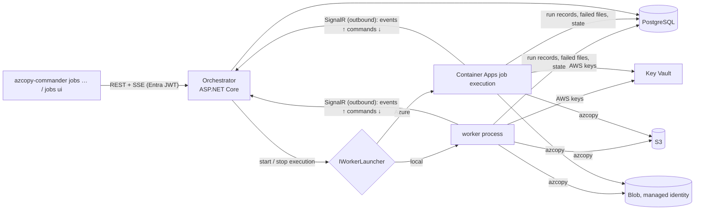
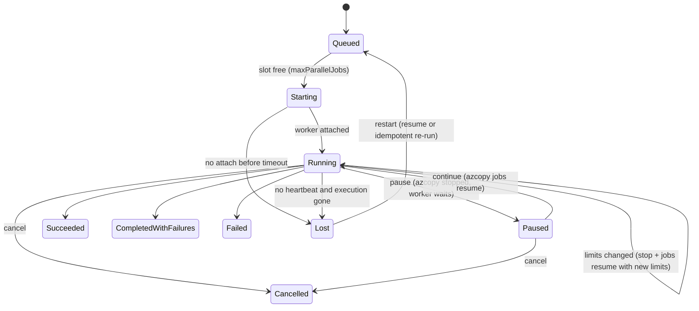

# Split azcopy-commander into an orchestrator service and per-job workers

Today one `azcopy-commander` process runs one azcopy job, and its run data is written to a local `runs/` folder. A job lasts only as long as that terminal stays open, and running several in parallel means opening several terminals.

Once this plan is done:
- An **orchestrator** service (an HTTP API secured with Entra ID) accepts copy, delta, retry and resume requests. It starts one **worker** per job and shows all jobs with live progress. While a job runs, you can cancel it, pause it, continue it and change its limits.
- **Workers** run as Azure Container Apps jobs and keep running when the orchestrator restarts. The orchestrator re-attaches to them when it comes back.
- The CLI gets a `jobs` command group and a dashboard of several jobs, both talking to the orchestrator.
- `copy`, `retry`, `resume`, `list` and `ui` still work on their own with local files and a SAS URL.

The work is split into three phases, each one verifiable on its own:
1. Split the code and run everything locally under Aspire.
2. Add the Azure pieces: Key Vault, managed identity and Entra ID.
3. Deploy to Azure Container Apps.

## What changes

### How the parts fit



A Container Apps job cannot accept incoming connections. Each worker therefore **connects out** to the orchestrator's SignalR hub. It sends events up that connection and receives commands back on it.

The worker writes its durable data straight to PostgreSQL: the run manifest, the azcopy job id, failed files, the copy log, the delta state and the final outcome. If the orchestrator is down, nothing is lost. Only the live view pauses until the worker reconnects. When the orchestrator starts, it reads the unfinished jobs from the database. Each worker reconnects with its job id and a token, and pending commands are delivered to it then.

### Projects

```text
src/
  AzCopyCommander/                 CLI exe: standalone commands (file-based), `jobs` remote commands, `ui`
  AzCopyCommander.Core/            job engine moved out of Shared/: azcopy, JobRunner, RunExecutor, inputs, store interfaces + file stores
  AzCopyCommander.Contracts/       API and hub DTOs, source-generated JSON context
  AzCopyCommander.Data/            EF Core DbContext, PostgreSQL stores, migrations
  AzCopyCommander.Orchestrator/    API, SSE, worker hub, scheduler, reconciler, worker launchers
  AzCopyCommander.Worker/          runs one job, then exits
  AzCopyCommander.AppHost/         Aspire 13.6 AppHost
  AzCopyCommander.ServiceDefaults/ telemetry, health checks
tests/
  AzCopyCommander.Tests/           existing CLI tests (unchanged behaviour)
  AzCopyCommander.TestSupport/     FakeAzCopy, FakeTimeProvider, RecordingView (moved)
  AzCopyCommander.Orchestrator.Tests/ AzCopyCommander.Worker.Tests/
```

Moving code into libraries enforces today's rule that `Shared/` never uses a feature: `Core` cannot reference the CLI. Code that only the CLI uses moves to `src/AzCopyCommander/Shared/`: `ConsoleIO`, `PlainView`, `RunPicker` and the wizard's dashboard. That lets the new multi-job dashboard reuse `DashboardView` without one feature using another.

### Core: the seams the worker needs

The job engine stays the same code. Its file access, console access and SAS handling go behind small interfaces, and today's behaviour becomes the file-based implementation:

```csharp
public interface IRunStore            // file: runs/<ts>-<kind>/run.json; db: runs + attempts tables
{
    RunRef Create(string kind, DateTimeOffset now);
    RunManifest Read(RunRef run);
    void Write(RunManifest manifest);
    IReadOnlyList<RunInfo> List();
    IReadOnlyList<string> FailedRelativePaths(RunRef run);   // every attempt, as retry reads today
}
public interface IStateStore { StateEntry? Get(string key); void Save(string key, StateEntry entry); } // date only moves forward
public interface IAttemptRecorder : IDisposable                // replaces the files JobRunner opens itself
{
    void Log(string level, string text);
    void Failure(FailedRecord record);
    void Complete(JobReport report);
}

public abstract record TargetAuth
{
    public sealed record Sas(string Query, string Sig) : TargetAuth;                    // CLI, as today
    public sealed record AutoLogin(string Type, string? ClientId) : TargetAuth;        // MSI in Azure, AZCLI locally
}
```

Other changes in `Core`:
- **Run identity.** A run is identified by a `RunRef` instead of a directory path. In the file store the `RunRef` is still the directory path, so `--run <dir>` keeps working.
- **No SAS on the target.** `BuildUrl` leaves out the `?` and `AzCopyArgs.Resume` leaves out `--destination-sas`. `RunExecutor` adds `AZCOPY_AUTO_LOGIN_TYPE` (and `AZCOPY_MSI_CLIENT_ID` when set) to the azcopy environment.
- **Limits.** New `JobLimits(int? Concurrency, int? CapMbps, double? BufferGb)` go into the job's environment explicitly (`AZCOPY_CONCURRENCY_VALUE`, `AZCOPY_BUFFER_GB`) and into the arguments (`--cap-mbps`). They are no longer only inherited from the process.
- **Interrupt reason.** `Interrupt` now says why it stops azcopy: `Cancel`, `Pause` or `Restart`. Only `Cancel` ends the job as *interrupted*.
- **No console in the engine.** `RunExecutor` loses its `ConsoleIO` dependency: the dry-run text and `RunHints` are built by the caller.

The CLI keeps the existing file-based `RunStore`, `StateStore` and `FailedList` behind these interfaces. The `runs/` layout and exit codes stay the same, and `RunFileCompatibilityTests` must keep passing.

### Contracts: API and hub

```csharp
public enum JobKind { Copy, Delta, Retry, Resume }

public sealed record StartJobRequest(
    JobKind Kind,
    SourceSpec? Source,              // bucket (name or ARN), prefix, region: copy and delta
    string? TargetUrl,               // https://acct.blob.core.windows.net/container[/prefix], no SAS
    string? LastCopyDate,            // ISO date or "auto": delta
    bool OverwriteModified,
    Guid? RunId,                     // retry / resume: the run to retry or continue
    JobLimits? Limits,
    string? AwsCredentialRef);       // Key Vault secret name; null = the configured default

public sealed record JobEvent(Guid JobId, long Seq, DateTimeOffset At, JobEventKind Kind, JsonElement Data);
// Kind: State, Progress (MetricsSnapshot with nullable EtaSeconds), Message, Failure, Log, Summary
```

```text
POST   /api/jobs                       start a job → 202 { id, state: "Queued" }
GET    /api/jobs?state=active          list
GET    /api/jobs/{id}                  details, latest metrics, attempts
GET    /api/jobs/{id}/events           SSE stream (Last-Event-ID resumes after a reconnect)
GET    /api/jobs/{id}/failures         failed files, paged
GET    /api/jobs/{id}/log              copy log, paged
POST   /api/jobs/{id}/cancel | pause | continue
PUT    /api/jobs/{id}/limits           { concurrency, capMbps, bufferGb }
GET|PUT /api/settings                  { maxParallelJobs }  (live)

hub /hubs/workers
  worker → orchestrator:  Attach(jobId, token) → JobAssignment;  Report(JobEvent[])
  orchestrator → worker:  Cancel(); Pause(); Continue(); SetLimits(JobLimits)
```

Callers (the CLI and the TUI) use REST to send commands and SSE to watch jobs. They need no SignalR client: .NET 10 has `TypedResults.ServerSentEvents` on the server and `SseParser` on the client.

### Job lifecycle



- **Pause, continue and limit changes** happen inside the same worker, so azcopy's plan files stay on that worker's local disk and `azcopy jobs resume` can find them. A limit change requested while azcopy is still **scanning** the source waits until scanning ends, because cancelling azcopy during enumeration makes the job impossible to resume.
- **Lost workers.** A worker that crashed or hit its time limit is found by a reconciler that runs every minute: no heartbeat, and the launcher reports the execution gone. The job is marked `Lost`. *Restart* starts a new worker:
  - When the plan files are reachable, it uses `jobs resume`.
  - When they are not, it re-runs the same `azcopy copy` with `--overwrite=false` (or `ifSourceNewer`, if the run used it). Blobs already copied are skipped, so the re-run is safe.
- **Concurrent jobs.** The scheduler allows only one active job per run, and one per delta state key (source + target). A conflicting request gets `409`.

### Worker

`AzCopyCommander.Worker` is a console program built on the .NET Generic Host. The steps it takes:
1. It reads `JOB_ID`, `ORCHESTRATOR_URL` and its token from the environment.
2. It attaches to the hub and receives the job spec.
3. It loads the AWS keys:
   - Phase 1: from its environment.
   - Phase 2: from the Key Vault secret `AwsCredentialRef`, using its managed identity.
4. It runs the existing `RunExecutor` with the PostgreSQL stores.

Two details of how the worker runs azcopy:
- **Events off the reader thread.** Events go through a buffering `IJobView` (a `Channel`) and are sent in batches about once per second. The azcopy reader thread runs under `JobRunner`'s lock and never waits on the network.
- **SIGTERM.** Container Apps stops a container with SIGTERM, which the current code does not handle. The worker registers `PosixSignalRegistration` for SIGTERM and stops azcopy cleanly. A hard kill follows if azcopy has not exited after a grace period.

### CLI: remote commands and dashboard

```text
$env:AZCOPY_COMMANDER_ORCHESTRATOR_URL = "https://orchestrator.example"
azcopy-commander jobs start copy  --source-bucket b --source-prefix data/2024 --target-url https://acct.blob.core.windows.net/c
azcopy-commander jobs start delta --source-bucket b --source-prefix data/2024 --target-url … --last-copy-date auto
azcopy-commander jobs start retry --run <run-id>
azcopy-commander jobs list
azcopy-commander jobs watch <job-id>          # the existing one-line progress, fed by SSE
azcopy-commander jobs cancel|pause|continue <job-id>
azcopy-commander jobs limits <job-id> --concurrency 64 --cap-mbps 2000
azcopy-commander jobs ui                       # multi-job dashboard
```

`jobs ui` is a table of the jobs (state, %, speed, ETA, failed count). Enter opens the existing `DashboardView` for one job. Keys act on the selected job: `c` cancel, `p` pause or continue, `l` limits. `jobs` is a new feature folder, `Features/Jobs/`, and it uses only `Contracts`. In phase 2 the CLI signs in with `Azure.Identity` (Azure CLI credential first, then the browser).

### Data

The PostgreSQL schema is owned by `AzCopyCommander.Data`, with EF Core migrations that the orchestrator applies when it starts:

| Table | Holds |
| --- | --- |
| `jobs` | request, state, worker execution id, token hash, limits, heartbeat |
| `runs` | the run manifest today kept in `run.json` (kind, source, target, retry-of, outcome, summary) |
| `attempts` | one row per azcopy process: azcopy job id, start/end, report |
| `failed_files` | one row per failed file and attempt (bulk insert) |
| `run_log` | copy log lines (level, time, redacted text) |
| `delta_state` | `state.json` entries; upsert only when the new date is later |
| `job_commands` | commands not yet delivered to a disconnected worker |

Existing `runs/` folders are not imported. The standalone CLI keeps using them.

## Steps

### Phase 1: split, contracts, worker and orchestrator under local Aspire

- [x] 1. Create `AzCopyCommander.Core` and move `Shared/{AzCopy,Jobs,Runs,Inputs,Common}` into it. Keep `ConsoleIO`, `PlainView`, `RunPicker` and the dashboard in the CLI under `Shared/`. Add `InternalsVisibleTo` for the tests. Change `SliceDependencyTests` to the new paths; the slice rule now covers only the CLI's features. All existing tests pass unchanged.
- [x] 2. Move `FakeAzCopy`, `FakeTimeProvider` and `RecordingView` to `tests/AzCopyCommander.TestSupport` (and drop the unused `using AzCopyCommander.Features.Wizard`).
- [x] 3. In `Core`:
  - Add `IRunStore`, `IStateStore`, `IAttemptRecorder` and `RunRef`, with today's file code as the implementation.
  - Make `RunManifest` read/write instance methods.
  - Remove `ConsoleIO` from `RunExecutor`.
  - Existing tests, including `RunFileCompatibilityTests`, pass.
- [x] 4. In `Core`: add `TargetAuth` (SAS or auto-login), `JobLimits` (environment and `--cap-mbps`) and the interrupt reason. Add tests for:
  - the arguments and environment with and without a SAS;
  - limits in `copy` and in `jobs resume`;
  - pause, then resume, through `FakeAzCopy`.
- [x] 5. Create `AzCopyCommander.Contracts` with the DTOs, the event kinds and a source-generated `JsonSerializerContext` (a NaN ETA becomes `null`).
- [x] 6. Create `AzCopyCommander.Data` with the `DbContext`, the PostgreSQL `IRunStore`, `IStateStore` and `IAttemptRecorder`, and the first migration. Write `delta_state` so the date only moves forward, in one statement.
- [x] 7. Create `AzCopyCommander.Worker`:
  - attach and receive the spec;
  - the buffering hub view, with a heartbeat every 20 s;
  - handle Cancel, Pause, Continue and SetLimits;
  - SIGTERM handling;
  - write the exit outcome to the database;
  - reconnect with backoff.
- [x] 8. Create `AzCopyCommander.Orchestrator`:
  - the REST endpoints and the SSE stream;
  - `WorkerHub`, the scheduler (`maxParallelJobs`, the 409 conflicts) and the reconciler;
  - `IWorkerLauncher` with `LocalProcessWorkerLauncher`, which starts `dotnet <worker.dll>` and passes the job id, token, connection string and `OTEL_*` variables.
- [x] 9. Create `AzCopyCommander.AppHost` and `ServiceDefaults` (Aspire 13.6):
  - PostgreSQL through `AddAzurePostgresFlexibleServer("pg").RunAsContainer().AddDatabase("db")`;
  - the orchestrator;
  - the worker project with `WithExplicitStart()`, so it is built and its path passed to the orchestrator;
  - AWS keys as secret `AddParameter`s;
  - target auth `AZCLI`.

  Add every project to `AzCopyCommander.slnx`.
- [x] 10. In the CLI, add `Features/Jobs`: the `jobs start|list|watch|cancel|pause|continue|limits` commands, the `--orchestrator` option and its environment variable, help text, and a line in `Composition`/`CliApp`.
- [x] 11. Add `jobs ui`: the job table, the detail view built on `DashboardView`, and the key actions. Add render tests on the in-memory terminal.
- [x] 12. Add a test-only fake azcopy executable (`tests/AzCopyCommander.FakeAzCopyCli`) that replays the `FakeAzCopy` scenarios, so the worker and the AppHost can run without S3.
- [x] 13. Update the README with the architecture, how to run the AppHost and the `jobs` commands.

### Phase 2: Key Vault, managed identity and Entra ID

- [x] 14. Worker: load the AWS keys from Key Vault (`Aspire.Azure.Security.KeyVault`, the secret named by `AwsCredentialRef` or the default) and register them with the redactor. Target auth becomes `MSI` with an optional `AZCOPY_MSI_CLIENT_ID`.
- [x] 15. Orchestrator API: add Entra ID JWT bearer auth (`Microsoft.Identity.Web`) with the app roles `Jobs.Read`, `Jobs.Control` and `Worker`. The hub accepts a worker token only for its own job id.
- [x] 16. Workers sign in to the hub with their managed identity (`Worker` role). The per-job random token stays as a second check, so a worker can attach only to its own job.
- [x] 17. CLI: sign in with `Azure.Identity` for the `jobs` commands, and add the `--tenant` / `--client-id` options with their environment variables.
- [x] 18. Database: use Entra authentication through the Aspire Azure Npgsql client in Azure, and password authentication locally.
  - Done in `Data` itself (`PostgresConnections`) rather than with the Aspire client: a connection string without a password signs in with `DefaultAzureCredential` (managed identity, `AZURE_CLIENT_ID`) and Npgsql's periodic password provider; the user name comes from the token when the string has none. No change in the services' `Program.cs`.
- [x] 19. After each attempt, upload azcopy's own log folder to a Blob container (`azcopy-logs/<run>/<attempt>`), since the container's disk is lost when the worker exits.

### Phase 3: deployment to Azure Container Apps

- [x] 20. Write a worker `Dockerfile`: a Linux image with azcopy pinned to a version (10.34.x), the worker as PID 1 or behind `tini`, and plan and log folders on local disk.
- [x] 21. AppHost: add `AddAzureContainerAppEnvironment`. Publish the worker with `PublishAsAzureContainerAppJob` (manual trigger, `ReplicaRetryLimit = 0`, `ReplicaTimeout` from config). Publish the orchestrator as a Container App with one replica and internal or authenticated ingress.
- [x] 22. Orchestrator: add `AcaJobWorkerLauncher`. It uses `ContainerAppJobResource.StartAsync` with environment overrides for the job id and token only, never secrets, and `StopExecutionJobAsync` for a hard stop. The reconciler reads the execution status.
- [x] 23. RBAC, set in Bicep through Aspire:
  - orchestrator identity: *Container Apps Jobs Operator* on the job;
  - worker identity: *Storage Blob Data Contributor* on the target and *Key Vault Secrets User* on the vault;
  - both identities: PostgreSQL Entra login.
  - Verified locally: `aspire publish` generates the Bicep (job manual trigger, retry limit 0, timeout 86400 s from `Worker:ReplicaTimeoutSeconds`, the Jobs Operator role scoped to the job, the Key Vault / Blob roles of the worker, Postgres roles of both identities). Not verified: the Docker build (no Docker here) and anything in Azure — see steps 24–25.
- [ ] 24. Run spikes against a real environment and record the results in the README:
  - the longest `replicaTimeout` accepted;
  - the SIGTERM → SIGKILL grace of a stopped execution;
  - plan file size for a large prefix against the ephemeral storage limit;
  - azcopy behaviour when interrupted during scanning with stdin closed.
- [ ] 25. Deploy with `azd up` and run the end-to-end check below against a test bucket.

## How it is verified

- [x] `dotnet test` stays green after each phase 1 step. The existing CLI tests are not changed except for project and namespace references.
- [x] Worker tests with `FakeAzCopy` and in-memory stores:
  - a copy reports progress and its summary;
  - cancel gives *interrupted*;
  - pause then continue calls `jobs resume` with the same id;
  - SetLimits restarts with the new `AZCOPY_CONCURRENCY_VALUE` and `--cap-mbps`;
  - SIGTERM gives a clean stop.
- [x] Orchestrator tests (`WebApplicationFactory` with a fake launcher):
  - the scheduler respects `maxParallelJobs`, and lowering it live queues new jobs;
  - a second job on the same run or state key gets `409`;
  - a worker that never attaches becomes `Lost`;
  - an orchestrator restart with jobs in `Running` re-attaches when workers reconnect, and pending commands are delivered.
- [ ] Data tests against PostgreSQL (the Aspire container through `Aspire.Hosting.Testing`; Docker required): the `delta_state` date never moves back, and failed files from all attempts are returned for a retry.
- [ ] Local end-to-end run under the AppHost with the fake azcopy executable:
  - start three jobs, then `jobs list` shows them in parallel;
  - `jobs watch` streams progress;
  - pause, continue, limits and cancel behave as above;
  - stopping and restarting the orchestrator project leaves the workers running, and they show up again.
- [ ] Phase 2: a call without a token gets `401`, and a `Jobs.Read` caller gets `403` on cancel. The worker reads the AWS keys from Key Vault, and no secret appears in `run_log`, events or the process environment of the orchestrator.
- [ ] Phase 3: a real copy of a small S3 prefix to a test container through the deployed orchestrator, then a delta with `auto`, a retry and a limits change during the copy.

## Decisions

| Decision | Choice | Why |
| --- | --- | --- |
| Database | PostgreSQL (Azure Flexible Server; a container locally) | Relational state, forward-only upserts and bulk failed files fit SQL. Aspire runs it as a container locally. Entra authentication works in Azure. |
| AWS keys | The request names a Key Vault secret; the orchestrator has a default | Lets one orchestrator serve several AWS accounts without code changes. |
| Worker ↔ orchestrator | SignalR hub, the worker connects out; one orchestrator replica | Container Apps jobs have no ingress. With a single replica there is no backplane to run. |
| Callers ↔ orchestrator | REST + SSE | No SignalR client in the CLI; SSE is built into .NET 10; `Last-Event-ID` replays missed events. |
| Who writes the durable data | The worker writes straight to PostgreSQL | No data is lost while the orchestrator is down; re-attaching only restores the live view. |
| azcopy plan files | On the worker's local disk; pause and limit changes stay in the same worker; a lost worker is restarted by `jobs resume` when it can, else by an idempotent re-run | Azure Files with memory-mapped plan files is unproven and slow. The append-only copy makes re-runs safe. |
| Pause | azcopy is stopped and the worker stays alive and idle | Keeps the plan files for `jobs resume`. It costs the compute of the idle worker. |
| Limit changes | Stop azcopy, then `jobs resume` with the new environment and `--cap-mbps`; deferred while scanning | azcopy reads its concurrency only at start. Cancelling during scanning makes the job impossible to resume. |
| Standalone CLI | Unchanged, file-based, SAS | As requested. The engine is shared through `Core`. |
| Existing `runs/` folders | Not imported into the database | Not needed for the split; an import command can come later. |
| Plan files too large for ephemeral disk | Decide from the phase 3 spike (step 24); the plan location stays configurable so an Azure Files (NFS) share can be mounted, or large migrations split into smaller prefixes | The plan was approved without choosing; the spike gives the data to choose. |

The plan was approved as written: PostgreSQL, per-job Key Vault secret references and *Pause keeps the worker alive* stand as chosen above.

## Risks

- **Scope.** This is a large change. Phase 1 is useful on its own, and each step keeps the existing tests green, which limits regressions in the CLI.
- **`replicaTimeout`** may not accept multi-day values (not confirmed). The reconciler restarts a `Lost` job, and the re-run is safe because the copy is append-only.
- **Interrupting azcopy while it scans** prompts for confirmation, and the launcher closes stdin. Limit changes wait until scanning ends, and the spike in step 24 checks how cancel behaves.
- **One orchestrator replica** means a short gap in the API during restarts and deployments. Workers carry on and reconnect, and no data is lost.
- **The *Container Apps Jobs Operator* role** lets the orchestrator start the job with any image. The orchestrator's identity and its API roles must be guarded accordingly.
- **Local development needs Docker** (PostgreSQL), and phase 2 needs an Azure subscription for Key Vault, which has no local emulator.

## Out of scope

- Importing existing `runs/` folders into the database.
- A web UI (the API is ready for one).
- More than one orchestrator replica (would need Azure SignalR Service or a backplane).
- A shared bandwidth limit across jobs; limits are per job, plus the maximum number of parallel jobs.
- Changes to `list`, which stays a local CLI command.

<details><summary>Evidence behind the main choices</summary>

- **Current code.**
  - `RunExecutor` builds the azcopy environment and writes `run.json` directly (`src/AzCopyCommander/Shared/Jobs/RunExecutor.cs`).
  - `JobRunner` opens the copy log and the failed list itself, and calls `IJobView` under its lock.
  - `AzCopyArgs.Resume` always passes `--destination-sas`.
  - `AzCopyLauncher` closes stdin and interrupts with SIGINT on Linux and `Process.Kill` on Windows.
  - Runs are identified by directory path throughout (`RunInfo.Dir`, `RetryOf`, `StateEntry.RunDir`).
- **Aspire 13.6.3.**
  - `PublishAsAzureContainerAppJob` (no longer experimental since 13.4) with manual trigger.
  - `AddAzurePostgresFlexibleServer(...).RunAsContainer()`.
  - `WithExplicitStart()` lets a resource be built without starting it.
  - Aspire cannot start one instance per job, hence `IWorkerLauncher`.
- **Container Apps jobs.**
  - No ingress, so the worker must connect out.
  - Started with `ContainerAppJobResource.StartAsync` and a template that overrides environment variables.
  - The role needed is *Container Apps Jobs Operator*.
  - Ingress has a 4-minute idle timeout, hence heartbeats.
- **azcopy 10.34.**
  - `AZCOPY_AUTO_LOGIN_TYPE=MSI` / `AZCLI`.
  - `jobs resume` accepts the global flag `--cap-mbps`, and needs no `--destination-sas` with OAuth.
  - Both SIGINT and SIGTERM give a clean cancel that can be resumed, except during enumeration.
- **Rejected alternatives.**
  - *gRPC streaming*: the same single-replica limit as SignalR, plus HTTP/2 ingress setup.
  - *A message queue*: more infrastructure for no gain with a single orchestrator.
  - *Azure Files for all run data*: the user chose a database; Azure Files remains the fallback for plan files only.

</details>
