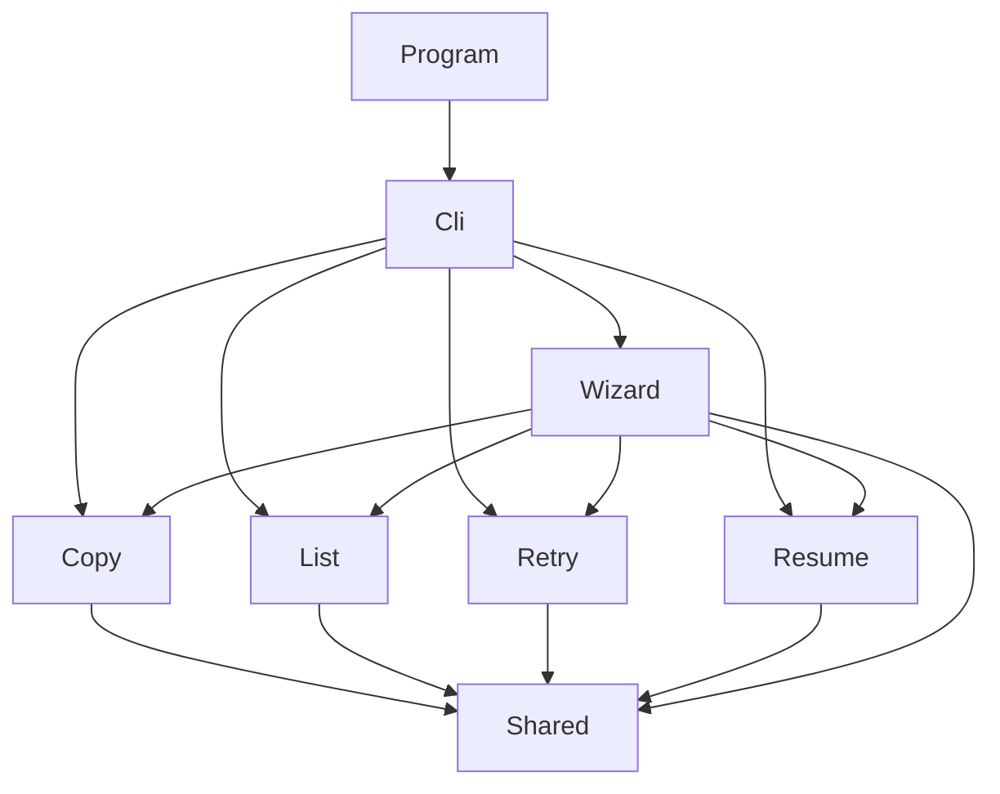

# Reorganise azcopy-commander into Vertical Slices

Today the folders answer "what kind of code is this?": `Commands/`, `Jobs/`, `Runs/`, `Ui/`, `Core/`. To change one command (say `retry`) you touch `Commands/MigrationCommands.cs` (331 lines, four commands in one class), `Commands/CommandOptions.cs`, `Cli/CliArguments.cs`, `Ui/Wizard.cs` and the "can this run be retried?" rule in `Runs/RunStore.cs`.

When the work is done the folders answer "what does the user do with it?". Each feature owns its request, its logic and its rules in one folder. Code shared by several features sits in `Shared/`, and a test fails if one feature reaches into another.

Behaviour does not change: same CLI, same output, same `run.json` / `state.json` / `failed-*.jsonl` bytes, same exit codes. This is a move-and-split refactor, so the existing 90 tests are the safety net.

## What changes

### The features

The application does five things for a user. Each is a slice.

| Slice | What the user does | Today it lives in |
| --- | --- | --- |
| `Copy` | `copy`: full copy, or delta with `--last-copy-date` (a mode of the same command, not a second slice) | `MigrationCommands.CopyAsync`, `ResolveLastCopyDate` |
| `List` | `list`: show what a copy would transfer | `MigrationCommands.ListAsync` |
| `Retry` | `retry`: re-copy the failed files of a run | `MigrationCommands.RetryAsync` |
| `Resume` | `resume`: continue an interrupted azcopy job | `MigrationCommands.ResumeAsync` |
| `Wizard` | `ui`: the interactive front end that drives the four above | `Ui/Wizard.cs`, `Ui/Secrets.cs`, `Ui/XenoAtomPrompter.cs`, dashboard |

`Cli/` (argument parsing, help, dispatch) is the application shell that routes to the slices. It is not a feature.

### Target layout

One project stays (`src/AzCopyCommander`). Folders match namespaces.

```text
src/AzCopyCommander/
  Program.cs
  Composition.cs                 (was Services.cs: wires the slices)
  Cli/                           shell: CliArguments, CliApp (dispatch), HelpText
  Features/
    Copy/      CopyCommand.cs, CopyRequest.cs
    List/      ListCommand.cs, ListRequest.cs
    Retry/     RetryCommand.cs, RetryRequest.cs
    Resume/    ResumeCommand.cs, ResumeRequest.cs
    Wizard/    Wizard.cs, WizardCredentials.cs, WizardSource.cs, Secrets.cs
      Prompts/    IPrompter.cs, XenoAtomPrompter.cs
      Dashboard/  DashboardModel.cs, DashboardView.cs, ResultPanel.cs
  Shared/
    AzCopy/    AzCopyLauncher, IAzCopyLauncher, AzCopyMessage, JobSummary, AzCopyArgs
    Jobs/      JobRunner, RunExecutor (new), IJobView, PlainView, Metrics, JobReport, SummaryLines
    Runs/      RunStore, RunManifest, StateStore, FailedList, JsonContext, RunPicker (new)
    Inputs/    SourceUrls, TargetSas, AwsCredentials, SharedInputs (new)
    Common/    ConsoleIO, ExitCodes, Outcomes, UsageException, Redactor, Dates, Format
```

The rule for `Shared/`: code goes there only when two or more slices use it today. Code used by one slice stays in that slice. That is why the dashboard and prompter live under `Wizard/` (only the wizard uses them) while `PlainView` and `IJobView` are in `Shared/Jobs` (the CLI and the wizard both use them).

### The dependency rule



- A slice may use `Shared/`. It may not use another slice.
- `Wizard` is the one exception: it is a front end over the four commands, so it may depend on them (through their request types and handler interface).
- `Shared/` never depends on a slice.

An architecture test enforces this (see Steps).

### Splitting `MigrationCommands`

`MigrationCommands` is the horizontal layer: four use cases plus the helpers they share. The use cases become slices; the helpers go to `Shared/` under the name of what they do.

| Helper today (private in `MigrationCommands`) | Used by | New home |
| --- | --- | --- |
| `ExecuteAsync` (dry run, run.json bookkeeping, calls `JobRunner`) | Copy, Retry, Resume | `Shared/Jobs/RunExecutor` |
| `ResolveRunDirAsync`, `AskYesNoAsync` (`--run` or latest run + confirm) | Retry, Resume | `Shared/Runs/RunPicker` |
| `NewRunDir`, `WithRunPaths` | Copy, Retry, Resume | `RunStore` (already owns run directories) |
| `ResolveSource`, `ReadTarget`, `RequireCredentials` | Copy, List (all four for the last two) | `Shared/Inputs/SharedInputs` |
| `AzCopyArgs` (`Copy`, `Resume`) | Copy, List, Retry, Resume | `Shared/AzCopy` |
| `ResolveLastCopyDate` | Copy only | stays in `Features/Copy` |
| the "no transfers" / list output logic | List only | stays in `Features/List` |

### One request type per slice

`CommandOptions` is one record with the fields of every command. `LastCopyDate` means nothing to `retry`; `Run` and `Yes` mean nothing to `copy`. Each slice gets its own request, plus a shared base for what all of them need:

```csharp
// Shared/Inputs
public abstract record CommandRequest
{
    public string? TargetSasUrl { get; init; }
    public AwsCredentials? Credentials { get; init; }
}

// Features/Copy/CopyRequest.cs
public sealed record CopyRequest : CommandRequest
{
    public string? SourceBucket { get; init; }
    public string? SourcePrefix { get; init; }
    public string? SourceRegion { get; init; }
    public string? LastCopyDate { get; init; }      // "auto", an ISO date, or null = full
    public bool OverwriteModified { get; init; }
    public IJobView? View { get; init; }
}

// Features/Retry/RetryRequest.cs
public sealed record RetryRequest : CommandRequest
{
    public string? Run { get; init; }
    public bool Yes { get; init; }
    public IJobView? View { get; init; }
}
```

The handlers share one small interface, which keeps the wizard testable with a spy, as `IMigrationCommands` does today:

```csharp
// Shared/Common
public interface ICommand<in TRequest>
{
    Task<int> RunAsync(TRequest request, CancellationToken cancellationToken);
}

// Features/Retry/RetryCommand.cs
public sealed class RetryCommand(GlobalOptions global, ConsoleIO io, RunStore runs, RunPicker picker,
    RunExecutor executor, TimeProvider time) : ICommand<RetryRequest>
{
    public async Task<int> RunAsync(RetryRequest request, CancellationToken cancellationToken) { /* moved from RetryAsync */ }

    /// <summary>The rule the wizard uses to offer a run: it recorded failed files.</summary>
    public static bool CanUse(RunInfo run) => run.Failed > 0;
}
```

`CliArguments` keeps the generic tokenizer (it owns the strict option grammar and the `--azcopy-arg` refusals). Turning the parsed options into a request becomes the job of the slice: `CopyRequest.From(ParsedArguments, env)`. `CliApp` keeps the `name -> handler` switch.

### Rules move to the slice that owns them

`RunInfo.CanRetry`, `CanResume` and `IsDeltaBase` are Retry, Resume and Copy rules sitting in `Runs/`. The wizard repeats them in `Wizard.CanUse`. After the move each slice owns its predicate (`RetryCommand.CanUse`, `ResumeCommand.CanUse`, `CopyCommand.IsDeltaBase`), the command and the wizard both call it, and the duplicate disappears.

### Wizard stays one slice

It is one interactive flow, not four. It is split into files by job, not by action: `Wizard.cs` (the menu and the run), `WizardCredentials.cs` (`AskAws`, `AskSas`), `WizardSource.cs` (`AskSource`, run labels). Per-action wizard steps inside each command slice were considered and left out: they would make every command slice depend on a prompter.

### Tests mirror the features

```text
tests/AzCopyCommander.Tests/
  Support/     FakeAzCopy, Harness, FakeTimeProvider, FakePrompter
  Features/    Copy/CopyTests, List/ListTests, Retry/RetryTests, Resume/ResumeTests, Wizard/WizardTests (+ Dashboard, Prompter tests)
  Shared/      Jobs, Runs (RunFileCompatibility), Inputs, AzCopy, Common
  Cli/         CliTests
  Architecture/SliceDependencyTests
```

`CommandTests.cs` (22 tests) and `CoreTests.cs` (12) are split by the feature each test exercises. Test code and names do not change except for namespaces and request types.

## Steps

Each step leaves the build and tests green and is one commit. Moves use `git mv` so history follows the files. The plan can stop after any phase.

**Phase 1: shared kernel (moves and namespaces only)**

- [ ] 1. Baseline: `dotnet test` is green on the current tree.
- [ ] 2. `git mv` into `Shared/Common` (`ConsoleIO`, `ExitCodes` and `Outcomes` as two files, `UsageException`, `Redactor`, `Dates`, `Format`), `Shared/AzCopy` (the `AzCopy/` files and `Commands/AzCopyArgs.cs`), `Shared/Inputs` (`SourceUrls`, `TargetSas`, `AwsCredentials` and `GlobalOptions` out of `CommandOptions.cs`). Fix namespaces and `using`s in `src` and `tests`.
- [ ] 3. `git mv` `Jobs/*` to `Shared/Jobs` and `Runs/*` to `Shared/Runs`. Same namespace fixes.

**Phase 2: split `MigrationCommands` into slices**

- [ ] 4. Extract the shared helpers while `MigrationCommands` still exists: `RunExecutor` (from `ExecuteAsync`), `RunPicker` (from `ResolveRunDirAsync`/`AskYesNoAsync`), `SharedInputs` (`ResolveSource`, `ReadTarget`, `RequireCredentials`), and `RunStore.WithRunPaths`/`NewRunDir`. `MigrationCommands` calls them. Tests unchanged and green.
- [ ] 5. Add `ICommand<TRequest>` and `CommandRequest`. Create `Features/List` (`ListRequest`, `ListCommand`), the smallest slice, as the template.
- [ ] 6. Create `Features/Copy`, then `Features/Retry`, then `Features/Resume` the same way (one commit each). Each slice moves its tests into `Features/<Name>/` and from `CommandOptions` to its request.
- [ ] 7. Move option binding into the slices (`XxxRequest.From`), make `CliApp` dispatch to the four handlers, rename `Services.cs` to `Composition.cs`, and delete `MigrationCommands`, `IMigrationCommands` and `CommandOptions`.

**Phase 3: wizard and rules**

- [ ] 8. `git mv` `Ui/Wizard.cs`, `Secrets.cs`, `IPrompter.cs`, `XenoAtomPrompter.cs` and the dashboard files into `Features/Wizard/...`. Give `Wizard` the four `ICommand<>` handlers instead of `IMigrationCommands`; `SpyCommands` becomes four spies (or one generic spy).
- [ ] 9. Split `Wizard.cs` into `Wizard`, `WizardCredentials`, `WizardSource` (pure cut and paste, no logic change).
- [ ] 10. Move the run-eligibility rules out of `RunInfo` into the slices and make `Wizard.CanUse` call them.

**Phase 4: guard rails and docs**

- [ ] 11. Add `Architecture/SliceDependencyTests`: for every `.cs` under `src/.../Features/<A>/`, fail if it has a `using AzCopyCommander.Features.<B>` with `B != A` (except `Wizard`), and for `Shared/` fail on any `using ...Features`. Plain text scan of the sources, no new package.
- [ ] 12. README: replace the code-layout paragraph (if any) with a short "Code layout" section that states the rule: a new command is a new folder under `Features/`.
- [ ] 13. Delete the emptied folders (`Commands/`, `Core/`, `Ui/`, old `Jobs/`, `Runs/`, `AzCopy/`).

## How it is verified

- [ ] After every step: `dotnet build` (warnings are errors) and `dotnet test` are green.
- [ ] `RunFileCompatibilityTests` (run.json, state.json, failed list byte for byte) still pass untouched, apart from namespaces.
- [ ] `dotnet run --project src/AzCopyCommander -- --help` prints the same text as before the work (diff against output saved in step 1).
- [ ] `git diff -M --stat <commit before step 1>` shows mostly renames; no logic change outside the files named in steps 4 to 10.
- [ ] `SliceDependencyTests` fails when a throwaway `using AzCopyCommander.Features.List;` is added to `Features/Copy` (check once by hand, then remove it).
- [ ] The `.ps1` scripts (`start.ps1`, `delta.ps1`, `retry.ps1`, `list-*.ps1`) still work: they call `dotnet run --project`, so no path changes are expected; confirm with `list-all.ps1 --help`.

## Decisions

| Decision | Choice | Why |
| --- | --- | --- |
| One project or one per slice | One project, folders and namespaces | About 2,300 lines; extra projects add csproj/solution churn and no benefit. The architecture test gives the boundary. |
| Mediator library (MediatR etc.) | No. Plain handler classes and a one-method `ICommand<TRequest>` | No new dependency; a switch in `CliApp` is enough for four commands. |
| Delta as its own slice | No: delta is `Copy` with a date | Same request, same azcopy call, same run manifest. |
| `Wizard` depends on the command slices | Allowed, only through requests and `ICommand<>` | It exists to drive them; the reverse is forbidden. |
| Dashboard, prompter placement | Under `Features/Wizard` | Only the wizard uses them. `PlainView`/`IJobView` stay shared because the CLI uses them too. |
| Typed requests vs keeping `CommandOptions` | Typed requests | Each command then states exactly the inputs it takes. Cost: about 60 call sites in tests change mechanically. |
| Option grammar | Stays central in `CliArguments` | The strict parser and the refused `--azcopy-arg` list are one rule for the whole CLI. |
| Behaviour changes | None; target and duplicate checks stay as they are | A pure refactor is reviewable by diff. Duplicates that fall out of the move (for example the "target does not match" check in Retry and Resume) may share a helper in `RunPicker`, nothing more. |

> **Open:** is the typed request split (step 5 to 7, the biggest test churn) wanted now? If you prefer a smaller first pass, I can keep `CommandOptions` as the single request for phase 2 and do typed requests later, without changing the rest of the plan.

## Risks

- **Namespace churn hides real changes in review.** Mitigation: one commit per step, renames via `git mv`, no logic edits in steps 1 to 3 and 8 to 9.
- **`internal` members used by tests** (`Wizard.RunLabel`, `JobRunner.Decide`, `DashboardView.Build`). `InternalsVisibleTo` stays, so moves keep them reachable; keep their accessibility.
- **Ordering of the JSON source-generated `JsonContext`.** It is in `Shared/Runs` and only its namespace changes; the compatibility tests cover it.

## Out of scope

- Behaviour changes, new features, or fixes of the review findings (see `2026-10-23-code-review-cleanup.md`, already done).
- Splitting into several assemblies, or adding a DI container or mediator package.
- Changing `run.json`, `state.json`, `failed-*.jsonl`, CLI options or exit codes.
- Per-action wizard steps owned by each command slice.

<details>
<summary>Evidence: what the current structure looks like</summary>

- Source files by size: `Commands/MigrationCommands.cs` 331 lines, `Ui/Wizard.cs` 309, `Jobs/JobRunner.cs` 228, `Ui/DashboardModel.cs` 170, `Ui/DashboardView.cs` 163, `Ui/XenoAtomPrompter.cs` 158.
- `MigrationCommands` holds four use cases and eight private helpers shared between them (`ExecuteAsync`, `ResolveRunDirAsync`, `ReadTarget`, ...).
- `CommandOptions` carries fields for all commands: `LastCopyDate` and `OverwriteModified` (copy/list), `Run` and `Yes` (retry/resume), `View` (copy/retry/resume only).
- The eligibility rules `CanRetry`, `CanResume`, `IsDeltaBase` are on `RunInfo` in `Runs/RunStore.cs`, and `Wizard.CanUse` repeats them.
- Existing seams already match slice boundaries: `IJobView` has two implementations (`PlainView`, `DashboardView`), `IPrompter` has a real and a fake one, `IAzCopyLauncher` a real and a fake one.
- Tests: `CommandTests.cs` (22) covers the four commands and shared run logic; `CoreTests.cs` (12) covers pure helpers; `WizardTests.cs` (18) uses `SpyCommands : IMigrationCommands`.
- `.gitignore` ignores `/runs/` only at the repository root, so `src/.../Runs/` is tracked (verified with `git ls-files`).
</details>
