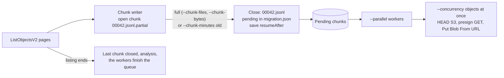

# azcopy-commander

Node.js tool that migrates a large S3 bucket to an Azure Blob container with the Azure SDK. Each object is copied
**server to server**: Azure reads it from a presigned S3 URL, so the data does not pass through the machine that runs the
tool. The S3 listing is cut into chunks as it goes, and each chunk is copied as soon as it is closed, while the listing
continues. The copy is **append-only** by default, shows live progress, writes timestamped logs and keeps a list of failed
files that the next attempt copies again.

The name is historical: up to version 1 the tool drove [AzCopy](https://aka.ms/downloadazcopy). Version 2 does not use
azcopy (see [Migration folders made with azcopy](#migration-folders-made-with-azcopy)).

Requirements: Node.js >= 20.12 and `npm install` once (it installs `@azure/storage-blob`, the AWS SDK for S3 and its
request presigner, and `@clack/prompts` for the terminal UI).

## Usage

```powershell
npm install
$env:AWS_ACCESS_KEY_ID     = "..."
$env:AWS_SECRET_ACCESS_KEY = "..."
$env:AZCOPY_COMMANDER_TARGET_SAS_URL = "https://acct.blob.core.windows.net/container?sv=...&sp=racwl&se=...&sig=..."

# A migration of everything under a prefix (listing and copy at the same time)
node bin/azcopy-commander.js migrate --source-bucket my-bucket --source-prefix data/2024 --source-region ap-southeast-2

# Continue it after Ctrl+C, a reboot or failed files (without --migration: the latest one, after confirmation)
node bin/azcopy-commander.js migrate --migration runs/20261113T020000Z-migration

# A delta: only the objects modified since the previous migration started (minus 10 minutes), and what it did not copy
node bin/azcopy-commander.js migrate --source-bucket my-bucket --source-prefix data/2024 --last-copy-date auto

# A full migration, then deltas one after another until one finds few objects (see "Keeping up with a growing bucket")
node bin/azcopy-commander.js migrate --source-bucket my-bucket --repeat

# Only list the source (prints `s3://bucket/key<TAB>size`, saves nothing, needs no SAS URL)
node bin/azcopy-commander.js list --source-bucket my-bucket --source-prefix data/2024 > files.txt

# The step-by-step wizard (also: no command, in a terminal)
node bin/azcopy-commander.js ui
```

`--dry-run` prints the phases and the options of a migration without creating anything; `--help` lists all options.

| Input | Option |
|---|---|
| Source bucket / sub path | `--source-bucket` (a name or an ARN, `arn:aws:s3:::bucket[/prefix]`), `--source-prefix` (S3 keys keep their layout: `<container>/<prefix>/<key>`) |
| Bucket region | `--source-region <region>`; without it the region is asked from S3 (`HeadBucket`) at the start. The presigned URLs are signed for that region. |
| Target container SAS URL | `--target-sas-url` or env `AZCOPY_COMMANDER_TARGET_SAS_URL`; must allow write (`racwl` recommended). A directory after the container is allowed: the blobs are written under it. |
| Delta mode | `--last-copy-date <ISO 8601 date>` (no zone = **UTC**) or `auto` |
| S3 credentials | env `AWS_ACCESS_KEY_ID`, `AWS_SECRET_ACCESS_KEY`, optional `AWS_SESSION_TOKEN` (never arguments). They need `s3:ListBucket` and `s3:GetObject` on the source. |

## How a migration runs

The listing and the copy run together in one process. The S3 `ListObjectsV2` listing (1,000 keys per page) writes chunk files; a pool of `--parallel` chunk workers copies the closed chunks, `--concurrency` objects at once in each.



A chunk is closed when it holds `--chunk-files` objects, when the next object would take it past `--chunk-bytes` (an object larger than that gets a chunk of its own), or when it has had objects for `--chunk-minutes` minutes. The last rule is for deltas, which find few modified objects in a listing that can take days: their objects are copied early instead of at the end. When the listing ends, the analysis (`inventory-summary.json`: counts, size classes, the largest objects, top-level prefixes, archived objects) is computed from the chunk files and printed.

| Option | Meaning |
|---|---|
| `--chunk-files <n>` | Most objects per chunk (default 100000) |
| `--chunk-bytes <size>` | Most bytes per chunk, e.g. `500GiB`, `2TiB` or a plain number (default 1TiB) |
| `--chunk-minutes <n>` | Close a chunk that has objects after n minutes (default 15) |
| `--parallel <n>` | Chunks copied at once (default 4) |
| `--concurrency <n>` | Objects copied at once in each chunk (default 32) |
| `--block-size <size>` | Above this size an object is copied in blocks (default 256MiB) |
| `--max-attempts <n>` | Copy attempts per chunk, retries of failed files included (default 5) |
| `--stop-after inventory` | List into chunks and analyse, copy nothing; continue the migration to copy |
| `--migration <dir>` | Continue this migration. The options it started with (source, chunk limits, block size) are kept; `--parallel`, `--concurrency` and `--max-attempts` can be changed. The SAS is asked for again (it is never written down) and must target the same container. |
| `--repeat` | After this migration, run delta migrations one after another (see [Keeping up with a growing bucket](#keeping-up-with-a-growing-bucket)). Not with `--stop-after`. |
| `--repeat-until <n>` | Stop repeating when a delta lists at most n objects (default 10000) |
| `--repeat-max <n>` | At most n delta migrations (default 10) |

Also accepted: `--source-prefix`, `--source-region`, `--last-copy-date`, `--overwrite-modified`, `--output-dir`, `--dry-run`, `-y/--yes`.

### How one object is copied

Each object is one S3 `HeadObject` (size, last-modified time, content headers and user metadata), then a server-side copy from a presigned GET URL:

* Up to `--block-size`: **Put Blob From URL** (one request). A zero-byte object is an ordinary empty upload.
* Above it: the blob is checked first (it exists: *ignored*, before any block is staged), then blocks of `max(--block-size, size / 50,000)` (at most 4,000 MiB) are staged with **Put Block From URL**, 8 at a time, and committed with one **Put Block List**.
* **Append-only**: every write has the condition `If-None-Match: *`, so an existing blob is never replaced, and nothing is deleted. A blob that exists is counted as *ignored*.
* **`--overwrite-modified`**: when the blob exists, it is written again with `If-Unmodified-Since: <S3 last-modified time>`, so it is replaced only when the S3 object is newer; otherwise the object is ignored. Replacing a blob discards its previous content: enable blob versioning or soft delete if old versions must stay recoverable. The comparison uses timestamps; an edit within the same second as the copy may be missed.
* **Headers and metadata**: `Content-Type`, `Content-Encoding`, `Content-Language`, `Content-Disposition` and `Cache-Control` are copied, and the S3 user metadata. A metadata name that is not valid in Azure (it must be a C# identifier, so not `original-filename`) is left out and logged once per chunk.
* **Results**: *copied*; *ignored* (already at the target); *missing* (the S3 HEAD is 404: the object was deleted after the listing; not retried, not carried); *failed* (any other error, after the SDKs' own retries), with a record in the chunk attempt's `failed-<ts>.jsonl`. One failed object does not fail the others.
* **Presigned URLs** are made per request (per block for large objects) with a one-hour expiry and are never logged or written down. A URL longer than the 2 KiB that Azure accepts for a copy source (usually a long `AWS_SESSION_TOKEN`) fails the object with the code `SourceUrlTooLong` without calling Azure.
* **Connections**: the S3 client gets an HTTPS agent with `--parallel` x `--concurrency` sockets.

### Chunk attempts, failures and Ctrl+C

A chunk attempt is a folder `chunks/00007/<timestamp>-chunk/` with `run.json`, `copy-<ts>.log` and `failed-<ts>.jsonl` (`relativePath`, source URL without query, destination, error code, size). A chunk is `success` when no object failed. With failed objects it is `partial`, and the next attempt copies just those (from the last `failed-*.jsonl`). An `interrupted` or `failed` attempt copies the whole chunk again; what is already at the target is ignored at one HEAD and one conditional request per object. After `--max-attempts` attempts a chunk is `exhausted`: the migration then ends `partial` (exit code 1), `migrate --migration` gives the exhausted chunks new attempts, and a delta based on it carries their failed files.

When every chunk is copied the migration is `success`; `success` or `partial` saves the **start of the migration** in `state.json` for this source and target, so `--last-copy-date auto` afterwards picks up what was written since.

Ctrl+C aborts the listing and the requests in flight, saves `migration.json` and exits with 130. `migrate --migration <dir>` continues: the closed chunks keep their status and the unfinished ones are copied again, and the listing starts again **after the last closed chunk** (`StartAfter`, from `resumeAfter` in `migration.json`). The open chunk is listed again, so no key is in two chunks. A listing that fails (an S3 error after the SDK's retries) lets the workers finish the closed chunks; the migration then ends `failed`, and continuing it lists again from the last closed chunk.

### The migration folder (`runs/<timestamp>-migration/`, `runs/<timestamp>-delta-migration/`)

```text
runs/20261113T020000Z-migration/
  migration.json                       format 2: the options, the state of the listing, one entry per chunk
  inventory-summary.json               the analysis, written when the listing ends
  chunks/00001.jsonl                   {"path":"a b.txt","size":10,"lastModified":"2024-03-01T10:00:00.000Z","storageClass":"STANDARD"}
  chunks/00043.jsonl.partial           the open chunk (deleted and listed again on continue)
  chunks/skipped.jsonl                 keys that are not copied, with the reason
  chunks/00001/20261113T020512Z-chunk/ one attempt: run.json, copy-<ts>.log, failed-<ts>.jsonl
  migration-<ts>.log                   phases, chunk starts and ends, the progress line every 30 s
```

| File | Content |
|---|---|
| `migration.json` | The options, the listing (`status`, `resumeAfter`: the full key of the last object of the last closed chunk, counts) and one entry per chunk (status, attempts, files, bytes, counters, attempt folders). A delta also records `includeAfter`, its `baseline` and the `carried` files. Written atomically. |
| `chunks/<id>.jsonl` | The inventory: one object per line, with the path relative to the prefix. JSON lines because S3 keys may contain tabs. There is no separate inventory file. |
| `chunks/skipped.jsonl` | Keys that are not copied: a key with a line break, and an object of an archive class (`GLACIER`, `DEEP_ARCHIVE`) that is not restored. A restored object is copied as usual. Reported in the analysis and the summary. |

No secret is written anywhere: the SAS URL, the AWS keys and the presigned URLs stay in memory, and the SAS signature and AWS secrets are redacted from logs and console output.

### Keeping up with a growing bucket

A full migration of a large bucket takes days, and objects keep arriving the whole time. A **delta migration** is an ordinary migration (its own folder, chunks, workers; it can be stopped and continued) whose listing keeps only the objects modified on/after a date. The usual workflow:

1. **Full migration**: `migrate --source-bucket my-bucket ...`. When it ends `success` or `partial`, its start is saved in `state.json`.
2. **Deltas**: `migrate --source-bucket my-bucket --last-copy-date auto` copies the objects modified since the previous migration started, minus 10 minutes, **plus the files that migration did not copy**. Repeat while the source keeps changing; each delta is shorter than the one before.
3. **Cutover**: when a delta finds few objects, stop the writers, run one last delta, and switch to the target.

`--repeat` does step 2 for you: after the migration it is given (a new one, or `--migration <dir>`), it runs deltas back to back, each based on the migration that just ended, until a delta lists at most `--repeat-until` objects (default 10,000), or `--repeat-max` deltas (default 10) have run, in which case it says that the source is still changing faster than the deltas catch up. The count that stops it is the listing of the delta, not the carried files: it measures how fast the source changes. A round that fails or is interrupted (Ctrl+C, exit 130; `migrate --migration <that delta> --repeat` continues) ends the loop; the exit code is that of the last round. Each round has its own folder, log and summary, and a repeat summary lists the rounds and prints the cutover command.

```text
Migration: runs\20261115T090000Z-delta-migration
Delta:     objects modified on/after 2026-11-12T01:50:00Z (start of runs\20261112T020000Z-migration, minus 10 min)
Carried:   1,204 file(s) that runs\20261112T020000Z-migration did not copy (2 chunk(s)), 3.10 GiB, in the first chunk(s)
```

* **Carried files.** When the baseline is a migration, the delta starts with what that migration did not copy: the failed files of the last attempt of each `exhausted` chunk. They are written as the delta's first chunks, marked `carried`, before the listing starts, so they are copied at once. A key that is both carried and modified stays in its carried chunk and is left out of the listed chunks: one key is in one chunk. The baseline migration is not changed; a file that fails again is carried into the next delta. A typed `--last-copy-date` carries nothing.
* **What a delta costs.** S3 cannot filter by date on the server, so every delta **lists the whole prefix** and filters as it goes: a delta takes at least as long as a full listing. `--chunk-minutes` makes it copy what it finds while it lists. The listing time sets the shortest gap between deltas, which is why `--repeat-until` defaults to 10,000 rather than 0 and the last step is to stop the writers.
* **Nothing to copy.** A delta with no modified objects and nothing carried ends as `success` with 0 chunks, and still moves the baseline forward.
* **The baseline only moves forward.** A migration that ends after a newer one was recorded (an older migration continued late) keeps the newer `state.json` entry, so `auto` never goes back in time.
* **Modified objects.** Without `--overwrite-modified`, an object rewritten after it was copied is listed but ignored (append-only); with it, the newer version replaces the blob.

> [!WARNING]
> An object uploaded in parts gets the time its upload **started** as its last-modified time. If such an upload starts more than 10 minutes before a migration and completes after the listing has passed its key, the object is in neither that migration nor the next delta. For buckets with long multipart uploads, pass an earlier explicit `--last-copy-date` to the last delta before cutover.

### Migration folders made with azcopy

A migration made by version 1 (azcopy; its `migration.json` has no `"format": 2`) cannot be continued: `migrate --migration` says so and names the folder. Start a new migration: what is already at the target is ignored. The old folder still works as the baseline of a delta: `--last-copy-date auto` reads `state.json`, and its failed files (from its `.txt` chunk lists and azcopy's failed lists) are carried. The commands `copy`, `retry` and `resume` and the options `--inventory-source`, `--azcopy-path`, `--azcopy-arg`, `--plan-dir` and `--run` were removed: `migrate` covers them, and `migrate --migration` retries failed files and continues interrupted work.

### Tuning and limits

* **Throughput** comes from the number of copy requests in flight, `--parallel` x `--concurrency` (default 128): Azure does the copying, and this machine only sends requests and waits. Raise `--concurrency` for many small objects; large objects are already split into blocks, 8 at a time.
* The first chunk closes after `--chunk-files` objects or `--chunk-minutes` minutes, so with the defaults the copy starts within minutes of the listing. The total size and the ETA are known only when the listing ends.
* **Not copied**: keys with a line break, archived objects that are not restored (restore them first, then run a delta), objects modified after the listing passed their key (run a delta).
* **The bucket must be readable from Azure with a presigned URL**: a bucket policy that limits access by source IP or VPC endpoint makes every copy fail with an authorization error.
* Temporary credentials: a presigned URL is valid at most as long as the session token it is signed with, and a long session token can make the URL too long (`SourceUrlTooLong`); prefer the keys of an IAM user for a long migration.
* Make sure the SAS outlives the migration (the tool warns when it expires in < 7 days). Continuing a migration needs the SAS again.
* Chunks run on this machine only. The chunk files of 10^7 - 10^8 objects take a few GB on disk.

## Listing only (`list`)

`list` takes the source options and prints each object of the source, one per line, as `s3://<bucket>/<key><TAB><size in bytes>`. A file count and total size go to stderr, so stdout can be redirected to a file. It uses the same S3 listing as `migrate`, needs no SAS URL, and writes nothing. `--last-copy-date` takes an explicit date only (`auto` needs saved state). It does not check the target, so objects already there are listed too.

## Terminal UI (`ui`)

```powershell
node bin/azcopy-commander.js ui      # or just: node bin/azcopy-commander.js  (in a terminal)
```

A step-by-step wizard instead of a long command line. It asks for:

1. **The action**: large migration, delta migration, continue a migration, list, or quit.
2. **AWS credentials**: taken from `AWS_ACCESS_KEY_ID` / `AWS_SECRET_ACCESS_KEY` when they are set (you choose *Use them* or *Enter other credentials*), otherwise typed with hidden input (plus an optional session token).
3. **The target SAS URL** (not for *List*): from `AZCOPY_COMMANDER_TARGET_SAS_URL` or typed hidden. It is validated as you type (container URL, signature, write permission, expiry); warnings such as "expires soon" are shown, the signature never is.
4. **The source**: bucket name **or ARN**, optional prefix and region, and whether to replace blobs when the S3 object is newer.
5. **The migration**: the most objects and the most data in a chunk, the chunks copied at once and the objects copied at once in each (defaults prefilled: 100,000 objects, 1TiB, 4, 32), and what happens when it ends (*Stop*, or *Keep running deltas until one finds at most N objects*, which is `--repeat` with `--repeat-until N`).
6. A **summary** and a confirmation, then the migration runs with a live dashboard (below).

Just before it starts, the wizard prints the command line that runs the same migration without the wizard, on a line of its own so you can copy it, for example `azcopy-commander migrate --source-bucket my-bucket --source-region ap-southeast-2 --chunk-files 100000 --chunk-bytes 1TiB --parallel 4 --concurrency 32 --output-dir C:\migrations\runs` (or `migrate --migration <folder> ...` when it continues one). No secret is in it: set `AWS_ACCESS_KEY_ID`, `AWS_SECRET_ACCESS_KEY` (and `AWS_SESSION_TOKEN`) and `AZCOPY_COMMANDER_TARGET_SAS_URL` before you run it. The output directory is made absolute, and values are quoted for PowerShell on Windows and for a POSIX shell elsewhere. A delta based on a migration picked in the wizard gets its date as `--last-copy-date`: run from the command line, it does not carry the files that migration did not copy (`--last-copy-date auto` does, from the latest migration of the same source and target).

A *delta migration* first asks for the baseline: a migration that ended `success` or `partial` (it fills in the source and `--overwrite-modified`, carries its failed files over and copies the objects modified since it started minus 10 minutes), or *Enter a date instead*, the only choice when no migration has finished yet; a target that differs from the baseline's asks for confirmation. *Continue a migration* lists the unfinished migrations in the output directory (`--output-dir`, default `./runs`), newest first, with their mode (`full` or `delta`), phase and chunks done, asks for the credentials again and continues the one you pick (a SAS for another target is refused; a migration made with azcopy is not offered).

**Options given on the command line** are picked up by the wizard (`azcopy-commander --source-bucket my-bucket --source-region ap-southeast-2 --parallel 4 --chunk-files 500000`, with or without `ui`). Right after you choose the action it lists the ones that apply and asks, as it does for secrets found in the environment, whether to *Use them* (the questions they answer are skipped) or to *Go through the questions with them filled in*. Details: `--source-bucket` makes the source complete, so an absent `--source-prefix` / `--source-region` means the whole bucket / the region asked from S3 (shown in the list; choose the second option to change them); `--last-copy-date` answers the delta migration's baseline question (including `auto`) and is applied to *List*; `--repeat`, `--repeat-until` and `--repeat-max` answer the *When it ends?* question; `--chunk-minutes`, `--block-size`, `--max-attempts` and `--stop-after` have no question and always apply to a migration; `--parallel`, `--concurrency` and `--max-attempts` apply when continuing one; `--target-sas-url` is used as is (it is visible in the process list of the machine, so the environment variable is the safer way). An option that cannot be used is reported and asked for as usual.

A migration started from the wizard on a terminal shows a live dashboard instead of the plain output: the listing with a running count until the first chunk is closed, then an overall bar with speed and ETA, a "listing" line while the listing still runs (the total so far has a `+`, and there is no ETA until it ends), chunks done / running / pending / out of attempts, one cell per running chunk, the latest failures (with their error code and chunk) and finally a result panel (green for success, yellow for failed files or an interrupt, red for a failure) with the most frequent error codes and the next step.

```text
◇  Migrating  my-bucket → files3
│
│  ⠹ Migrating                                           elapsed 2h 41m
│  listing ░░░░░░░██████░░░░░░░░  3,100,000 objects listed · 190 chunk(s) so far
│  ███████████░░░░░░░░░░░░░░░░░░░░░░░░░░           44.10 TiB / 184.20 TiB+
│  speed 1.62 GiB/s  ▂▃▅▆▇▇▆▇   ETA after listing
│  chunks ✔ 42  ▶ 4  144 pending  ✖ 0      copied 3,012,554   ignored 0   ✖ failed 3
│  ▶ 00043 ███████░░░  71% ▶ 00044 ██░░░░░░░░  18% ▶ 00045 █████░░░░░  52% ▶ 00046 ░░░░░░░░░░   2%
│  ✖ AuthorizationFailure  data/2024/big file.bin   (chunk 00009)
│  log  runs\20261112T020000Z-migration\migration-20261112T020000Z.log
```

Narrow terminals (< 60 columns) show a compact version without the sparkline, running chunks, failures and log path, and below 36 columns a single line. Warnings are printed above the dashboard. Colours follow `NO_COLOR` / `FORCE_COLOR`, and the symbols fall back to ASCII when the terminal is not UTF-8. The log files, `migration.json` and exit codes are the same as with the plain output.

Secrets are kept **in memory only**: there is no flag for them, and nothing about them is written to `migration.json`, `state.json`, the logs, the failed-file lists or the command line. Typed AWS values are set in the environment of this process for the duration of the run (that is where the S3 client reads them) and restored afterwards; the SAS URL is passed to the command in memory. The wizard never offers to save credentials. Ctrl+C at any prompt cancels (exit code 130); during a migration it stops it as described above. Long paths and URLs are shortened in the middle to fit the terminal width. `ui` refuses to start without a terminal (exit code 64). `--output-dir` and `--dry-run` apply to the wizard too.

## Progress

On the command line, a live line on a terminal, and one line every 30 s in the migration log (and on stdout when it is not a terminal):

```text
LISTING+COPYING | listed 4,200,000 (42 chunks) | chunks 37/42 done, 4 running | copied 3,512,004 | ignored 0 | failed 3 | 70.10 TiB / 74.22 TiB+ | 1.62 GiB/s | ETA after listing
```

Each chunk that ends prints one line with its status and counters, and the migration ends with a summary (chunks, files copied / failed / ignored / missing, data copied, the keys not copied and how to continue).

Exit codes: `0` ok, `1` completed with failed files, `2` failed, `64` usage error, `130` interrupted.

## Development

`npm test` runs the unit and end-to-end tests. They use in-memory fakes of S3 (`listPage`, `headObject`, `presignGet`) and of a blob container (blobs in a `Map`, conditional writes as Azure does them, injectable failures and delays), in `test/fakes.js`; no network is used.

## What was and was not verified

* **Version 2 (Azure SDK) is verified with the fakes only.** It has not been run against a real S3 bucket or storage account yet: the 319-object bucket used for version 1 was not available. The tests cover: copying starts while the listing runs (a listing held at page 3 until chunk 1 is copied); chunk boundaries by files, by bytes and by age; a delta that finds 3 objects in a long listing copies them before the listing ends; Ctrl+C during the listing and during the copy, and continuing, with every key in exactly one chunk and copied once; a failed listing; append-only, `--overwrite-modified`, zero-byte objects, staged blocks above `--block-size`, S3 404 as missing, `SourceUrlTooLong`, invalid metadata names; archived and restored objects; retries of failed files, exhausted chunks carried into a delta; the `--parallel` and `--concurrency` limits; no secret or presigned signature on disk or on screen; a migration folder made with azcopy; `list`; the wizard flows and the dashboard with scripted prompts and a fake terminal.
* **Not verified, needed before a production-size run**: a real copy (Put Blob From URL and Put Block From URL from presigned S3 URLs, key names with spaces and non-ASCII characters, content headers and metadata at the target, the error codes Azure returns for an existing blob and an unreadable source); the region lookup with `HeadBucket`; the throughput of `--parallel` x `--concurrency` and the S3 request rate it causes; the listing of millions of keys; interactive use of the dashboard in Windows Terminal.

### Before 2.0 (azcopy)

The notes below are the record of version 1, which drove azcopy. They describe commands and options that no longer exist (`copy`, `retry`, `resume`, `--inventory-source`), and are kept for what they say about the source bucket and the target.

* **Verified against real infrastructure** (azcopy 10.34.1, an S3 bucket in ap-southeast-2 with 319 objects / 6.16 GiB, an Azure Blob container; 2026-11-13). Each of these ran for real and was compared with the source:
  * `migrate`, full: both inventory providers (`azcopy` dry run and `--inventory-source s3`) list the same 319 keys and sizes; 4 chunks with `--chunk-files 100 --parallel 3` copied all 319 files; the target holds exactly the same blob names and sizes. So **`--list-of-files` with an S3 source copies exactly the listed keys to the right blob names**, including keys with spaces and non-ASCII characters (`café-日本.txt`); the `--include-path` fallback is not needed.
  * `migrate`, delta: with 3 new objects in the source, `--last-copy-date auto --repeat --repeat-until 5` produced an inventory of exactly those 3 keys (`--include-after` against S3 works), copied them, and stopped as "caught up". The S3 provider filters on `LastModified` correctly with an explicit date. A second `auto` delta re-lists objects inside the 10-minute overlap and azcopy ignores them (append-only). A baseline that ended `partial` carried its failed file into the next delta as the first chunk (1 file, 23 B) while the delta's own inventory held 0 objects.
  * `migrate` interrupted: three chunks killed mid-copy (process killed) were continued with `migrate --migration`; azcopy skipped the 96 files already at the target, copied the rest, and the target matched the inventory.
  * `copy` (full, repeated, delta with a date, `--overwrite-modified`), `list` with a date, `retry` and `resume`. A repeated copy ignores every file; without `--overwrite-modified` an S3 object rewritten after the copy is skipped, and with it (`--overwrite=ifSourceNewer`) the blob content is replaced. `retry` runs azcopy with `--list-of-files` against an S3 source and retries exactly the failed file. The `Progress`/`EndOfJob` payloads parse, and a failed transfer reports the S3 source and Azure destination, which `failed-*.jsonl` records.
  * The `s3` inventory warns about an archived (`GLACIER`) object before any copy.
* **What real azcopy did that the fakes did not predict** (see the limits of `migrate` above):
  * **One 403 on a source object cancels the whole job.** A `GLACIER` object makes azcopy end the job as `Cancelled` (exit 2) instead of `CompletedWithErrors`; other files in the job may or may not be copied, and the job's `copied`/`failed` counters can read 0. Check for archived objects (the `s3` inventory warns) and restore them first.
  * **A retry pass with only still-failing files ends `Failed`.** azcopy reports `Failed` when every transfer of a job fails, so a chunk whose retry pass holds only failing files used to end `failed`, and a one-chunk migration then ended `failed` (exit 2) with no baseline, and a delta after it carried the whole chunk list. **Fixed:** a retry pass that ends `Failed` after an earlier attempt copied the rest is counted as `partial`, so the chunk is retried or exhausted as `partial`, the migration records its baseline, and a delta carries only the failed paths (covered by the fake azcopy with `FAKE_ALL_FAILED`). A *first* pass in which every file fails is still `failed`, and a `Cancelled` job stays failed.
* `migrate` is also verified against the fake azcopy (inventory, analysis, chunk boundaries, the worker pool and its limit, retries, interruption and continuation, `--stop-after`, `--dry-run`, delta migrations with carried-over files, `--repeat`, the forward-only baseline, no secrets on disk or screen) and against a fake S3 client; the wizard flows and the migration dashboard with scripted prompts and a fake terminal. These cover what the real run could not produce: the carried-over whole list of a chunk whose job failed, `--repeat-max`, and several rounds of `--repeat`.
* **Not verified, needed before a production-size run** (the bucket used has only 319 objects): (a) ten azcopy jobs at once with separate plan folders: memory and connections on the machine, and whether azcopy looks up each listed path in S3 on its own (more requests, slower start per chunk) (3 jobs at once worked); (b) the time and memory of the azcopy dry-run inventory of a large prefix, to decide whether `--inventory-source s3` should be the default; (c) the AWS SDK listing of millions of keys (319 listed correctly); (d) `--repeat` over several rounds against a source that keeps growing; (e) Ctrl+C (instead of killing the process) during a copy or migration.
* Verified with the real azcopy 10.32.8 and 10.34.1: all flags used are accepted; `--as-subdir=false` keeps the source layout (checked with a local
  source in `--dry-run`); JSON `Init`/`Error` messages parse; `--dry-run --output-type json --log-level NONE` emits `Dryrun` messages (`Source`, `SourceSize`, `EntityType`) and writes nothing under `~/.azcopy` (checked with a local source); a copy with invalid AWS credentials is reported as a failed run.
* Verified for the terminal UI: the flow against a scripted fake of the prompt library and a fake azcopy (tests), and the real prompt library rendering the menu from piped keystrokes. The dashboard is verified through its renderer at several widths and a fake terminal stream (one write per redraw, cursor handling, result panel). Not verified: interactive use, resizing and Ctrl+C during a copy in Windows Terminal at different widths and with `NO_COLOR=1`.
* Not verified: the "no transfers were scheduled" message azcopy may print when a delta run matches nothing (a delta with a date of "now" simply ended `Completed` with 0 files discovered), and the exact `Src`/`Source` format azcopy reports for S3 objects in `list` for keys with special characters.
* `retry` relies on azcopy's `--list-of-files`, a flag that exists but is missing from `azcopy copy --help`. It works with S3 sources (verified: it retried exactly the failed file). If it ever does not, re-run the same `copy` (append-only runs are idempotent) or use `resume`.
