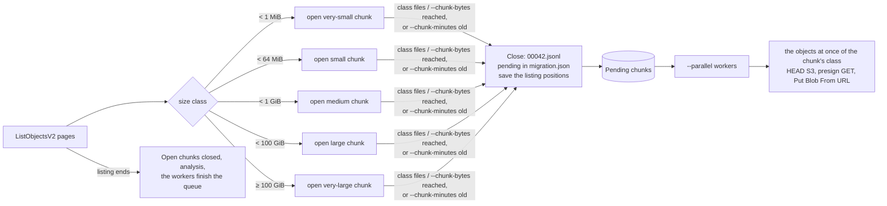

# How azcopy-commander works

This page is the reference for operators of a large migration: how the listing and the copy run, what is written to
disk, how failures and Ctrl+C are handled, how delta migrations keep up with a growing bucket, and the limits to know
before a multi-day run. For installation and a first migration, see the [README](../README.md).

- [How a migration runs](#how-a-migration-runs)
- [Size classes and size profiles](#size-classes-and-size-profiles)
- [How one object is copied](#how-one-object-is-copied)
- [Failures, retries and Ctrl+C](#failures-retries-and-ctrlc)
- [The migration folder](#the-migration-folder)
- [Delta migrations and cutover](#delta-migrations-and-cutover)
- [Terminal UI and dashboard](#terminal-ui-and-dashboard)
- [Tuning and limits](#tuning-and-limits)

## How a migration runs

The listing and the copy run together in one process. The S3 `ListObjectsV2` listing (1,000 keys per page) writes each
object into the open chunk of its **size class**. A pool of `--parallel` workers copies the closed chunks in the order
they close, each with the number of objects at once of its class.



A chunk is closed when:

- it holds the files per chunk of its class;
- the next object would take it past `--chunk-bytes` (or the `chunkBytes` of its class; an object larger than that gets
  a chunk of its own);
- or it has had objects for `--chunk-minutes` minutes (default 15). This is for deltas, which find few modified objects
  in a listing that can take days: their objects are copied early instead of at the end.

Each class has its own open chunk, closed on its own. When the listing ends, the analysis (`inventory-summary.json`:
counts, size classes, the largest objects, top-level prefixes, archived objects) is computed from the chunk files and
printed. `--stop-after inventory` stops there and copies nothing; continue the migration to copy.

## Size classes and size profiles

A fixed number of objects at once does not fit every chunk: 32 is too few for 4 KiB files and too many for 200 GiB
files. So each object goes to the chunk of its size class, and each class has its own copy profile. The defaults:

| Class | Size | Files per chunk | Objects at once |
| --- | --- | ---: | ---: |
| `very-small` | < 1 MiB | 100,000 | 128 |
| `small` | 1 MiB – < 64 MiB | 50,000 | 64 |
| `medium` | 64 MiB – < 1 GiB | 10,000 | 16 |
| `large` | 1 GiB – < 100 GiB | 1,000 | 8 |
| `very-large` | ≥ 100 GiB | 50 | 2 |

Objects above `--block-size` are already copied 8 blocks at a time, so the large classes need few objects at once.
`--chunk-bytes` and `--chunk-minutes` apply to every class; a class may have its own `chunkBytes`.

To change the classes, start from the defaults:

```sh
azcopy-commander --generate-size-profile profile.json
```

It writes the default classes to `profile.json` (unchanged, the file behaves like no profile), prints the class table
and the command that uses it, and never replaces an existing file. Edit it, for example:

```json
{
  "classes": [
    { "name": "very-small", "below": "1MiB",   "chunkFiles": 100000, "concurrency": 128 },
    { "name": "small",      "below": "64MiB",  "chunkFiles": 50000,  "concurrency": 64 },
    { "name": "medium",     "below": "1GiB",   "chunkFiles": 10000,  "concurrency": 16 },
    { "name": "large",      "below": "100GiB", "chunkFiles": 1000,   "concurrency": 8, "chunkBytes": "4TiB" },
    { "name": "very-large",                     "chunkFiles": 50,     "concurrency": 2 }
  ]
}
```

```sh
azcopy-commander migrate --source-bucket my-bucket --size-profile ./profile.json --parallel 4
```

Rules for a profile: it replaces the whole list; 1 to 10 classes; names of lower-case letters, digits and dashes;
`below` grows from one class to the next and the last class has none; sizes are numbers of bytes or texts such as
`64MiB`.

The classes are saved in `migration.json`, so a continued migration and the deltas of `--repeat` chunk the same way.
When continuing, `--size-profile` may be given again to change the `concurrency` of each class (matched by name);
changes to bounds or files per chunk are reported and ignored, since the chunks already exist.

**Uniform chunks**: a migration given `--chunk-files` or `--concurrency` (and no `--size-profile`) has one kind of
chunk: at most `--chunk-files` objects (default 100,000), copied `--concurrency` at once (default 32). Migrations
started before size classes existed are uniform and are continued as before.

## How one object is copied

Each object is one S3 `HeadObject` (size, last-modified time, content headers, user metadata), then a server-side copy
from a presigned GET URL:

- **Up to `--block-size`** (default 256 MiB): one **Put Blob From URL** request. A zero-byte object is an ordinary empty
  upload.
- **Above it**: if the blob already exists it is *ignored* before any block is staged; otherwise blocks of
  `max(--block-size, size / 50,000)` (at most 4,000 MiB) are staged with **Put Block From URL**, 8 at a time, and
  committed with one **Put Block List**.
- **Append-only**: every write has the condition `If-None-Match: *`, so an existing blob is never replaced, and nothing
  is ever deleted.
- **`--overwrite-modified`**: an existing blob is written again with `If-Unmodified-Since: <S3 last-modified time>`,
  so it is replaced only when the S3 object is newer. Replacing a blob discards its previous content: enable blob
  versioning or soft delete if old versions must stay recoverable. An edit within the same second as the copy may be
  missed.
- **Headers and metadata**: `Content-Type`, `Content-Encoding`, `Content-Language`, `Content-Disposition`,
  `Cache-Control` and the S3 user metadata are copied. A metadata name that is not valid in Azure (it must be a C#
  identifier, so not `original-filename`) is left out and logged once per chunk.
- **Presigned URLs** are made per request (per block for large objects), expire after one hour, and are never logged or
  written down. A URL longer than the 2 KiB Azure accepts as a copy source (usually because of a long
  `AWS_SESSION_TOKEN`) fails the object with `SourceUrlTooLong`.

Each object ends as one of:

| Result | Meaning |
| --- | --- |
| *copied* | Written to the target. |
| *ignored* | Already at the target (append-only), or not newer with `--overwrite-modified`. |
| *missing* | The S3 HEAD returned 404: deleted after the listing. Not retried. |
| *failed* | Any other error, after the SDKs' own retries. Recorded in the attempt's `failed-<ts>.jsonl`. |

One failed object does not fail the others.

## Failures, retries and Ctrl+C

Each copy of a chunk is an **attempt**, a folder `chunks/00007/<timestamp>-chunk/` with `run.json`, `copy-<ts>.log` and
`failed-<ts>.jsonl`.

- A chunk with no failed object is `success`.
- With failed objects it is `partial`, and the next attempt copies just those.
- An `interrupted` or `failed` attempt copies the whole chunk again; objects already at the target are ignored at the
  cost of a HEAD and a conditional request each.
- After `--max-attempts` attempts (default 5) a chunk is `exhausted`. The migration then ends `partial` (exit code 1).
  `migrate --migration <dir>` gives exhausted chunks new attempts, and a delta based on the migration carries their
  failed files.

When every chunk is copied the migration is `success`. A `success` or `partial` migration saves its start time in
`state.json`, for `--last-copy-date auto`.

**Ctrl+C** aborts the listing and the requests in flight, saves `migration.json` and exits with 130.
`migrate --migration <dir>` continues: closed chunks keep their status, unfinished ones are copied again, and the
listing restarts (`StartAfter`) from the last point where every listed key is in a closed chunk. Since several chunks
are open at once (one per class), `migration.json` records per class how far its keys are in closed chunks, so on
continue no key is lost and none ends up in two chunks. Since every open chunk closes after `--chunk-minutes`, a
continued listing lists again at most about that much.

A listing that fails (an S3 error after the SDK's retries) lets the workers finish the closed chunks; the migration then
ends `failed`, and continuing it lists again from the last closed chunk.

## The migration folder

Each migration gets a folder under `--output-dir` (default `./runs`): `<timestamp>-migration` or
`<timestamp>-delta-migration`.

```text
runs/20261113T020000Z-migration/
  migration.json                       the options, the state of the listing, one entry per chunk
  inventory-summary.json               the analysis, written when the listing ends
  chunks/00001.jsonl                   {"path":"a b.txt","size":10,"lastModified":"2024-03-01T10:00:00.000Z","storageClass":"STANDARD"}
  chunks/00043.jsonl.partial           an open chunk (deleted and listed again on continue)
  chunks/skipped.jsonl                 keys that are not copied, with the reason
  chunks/00001/20261113T020512Z-chunk/ one attempt: run.json, copy-<ts>.log, failed-<ts>.jsonl
  migration-<ts>.log                   phases, chunk starts and ends, a progress line every 30 s
runs/state.json                        the start of the last successful migration per source and target
```

- `migration.json` holds the options (with the size classes), the listing position, and one entry per chunk (status,
  attempts, files, bytes, size class, counters). A delta also records its date, its baseline and its carried files. It
  is written atomically.
- `chunks/<id>.jsonl` is the inventory: one object per line, path relative to the prefix. JSON lines, because S3 keys
  may contain tabs.
- `chunks/skipped.jsonl` lists keys that are not copied: keys with a line break, and archived objects (`GLACIER`,
  `DEEP_ARCHIVE`) that are not restored. Restored objects are copied as usual.

No secret is written anywhere: the SAS URL, the AWS keys and the presigned URLs stay in memory, and the SAS signature
and AWS secrets are redacted from logs and console output.

## Delta migrations and cutover

A full migration of a large bucket takes days, and objects keep arriving the whole time. A **delta migration** is an
ordinary migration (its own folder and chunks; it can be stopped and continued) whose listing keeps only the objects
modified on or after a date. The usual workflow:

1. **Full migration**: `migrate --source-bucket my-bucket ...`. When it ends `success` or `partial`, its start is saved
   in `state.json`.
2. **Deltas**: `migrate --source-bucket my-bucket --last-copy-date auto` copies the objects modified since the previous
   migration started (minus 10 minutes), **plus the files that migration did not copy**. Each delta is shorter than the
   one before.
3. **Cutover**: when a delta finds few objects, stop the writers, run one last delta, and switch to the target.

`--repeat` automates step 2: after the migration, it runs deltas back to back, each based on the one that just ended,
until a delta lists at most `--repeat-until` objects (default 10,000) or `--repeat-max` deltas (default 10) have run. It
then prints a summary of the rounds and the cutover command. A round that fails or is interrupted ends the loop
(`migrate --migration <that delta> --repeat` continues); the exit code is that of the last round.

```text
Migration: runs\20261115T090000Z-delta-migration
Delta:     objects modified on/after 2026-11-12T01:50:00Z (start of runs\20261112T020000Z-migration, minus 10 min)
Carried:   1,204 file(s) that runs\20261112T020000Z-migration did not copy (2 chunk(s)), 3.10 GiB, in the first chunk(s)
```

- **Carried files.** With `--last-copy-date auto` (or a baseline picked in the wizard), the delta starts with the failed
  files of the baseline's exhausted chunks, as its first chunks, before the listing starts. A file that fails again is
  carried into the next delta. An explicit date carries nothing.
- **What a delta costs.** S3 cannot filter by date on the server, so every delta **lists the whole prefix** and filters
  as it goes: a delta takes at least as long as a full listing. This is why `--repeat-until` defaults to 10,000 rather
  than 0, and why the last step is to stop the writers.
- **Nothing to copy.** A delta that finds nothing ends `success` with 0 chunks, and still moves the baseline forward.
- **The baseline only moves forward**: `auto` never goes back in time, even when an older migration is continued late.
- **Modified objects.** Without `--overwrite-modified`, an object rewritten after it was copied is listed but ignored;
  with it, the newer version replaces the blob.

> [!WARNING]
> An object uploaded in parts gets the time its upload **started** as its last-modified time. If such an upload starts
> more than 10 minutes before a migration and completes after the listing has passed its key, the object is in neither
> that migration nor the next delta. For buckets with long multipart uploads, give the last delta before cutover an
> earlier explicit `--last-copy-date`.

## Terminal UI and dashboard

`azcopy-commander` with no command (in a terminal), or `azcopy-commander ui`, starts a step-by-step wizard. It asks for
the action (migration, delta, continue, list), the AWS credentials and the SAS URL (taken from the environment, or
typed with hidden input), the source, and how to chunk and when to stop. Options given on the command line are offered
to the wizard, which then skips those questions. Before it starts, it prints the equivalent command line (without
secrets) so you can rerun it without the wizard.

While a migration runs, the wizard shows a full-screen dashboard; the normal screen comes back at the end with a result
panel (green for success, yellow for failed files or an interrupt, red for a failure) and the next step.

```text
 Migrating  my-bucket → files3                                                          ⠹ elapsed 2h 14m
───────────────────────────────────────────────────────────────────────────────────────────────────────────
 overall   ██████████████████░░░░░░░░░░░░░░░░░░░░░░░░░░░░░░  23.9%    44.10 TiB / 184.20 TiB+
 speed     1.62 GiB/s  ▂▃▅▆▇▇▆▇   average 1.40 GiB/s   ETA after listing
 listing   3,100,000 objects listed · 190 chunks so far
 objects   copied 3,012,554 · ignored 0 · missing 0 · failed 3        errors AuthorizationFailure 3
 chunks    ✔ 42 done · ▶ 3 running · 144 pending · ✖ 1 out of attempts
── Chunks being copied (4 workers) ────────────────────────────────────────────────────────────────────────
 1 ▶ 00013 very-small ███████████░░░░  71%   71,012 / 100,000 obj    612 MiB / 860 MiB    12.3 MiB/s  try 1
 2 ▶ 00014 small      ███░░░░░░░░░░░░  18%    9,100 /  50,000 obj    410 GiB / 1.00 TiB    310 MiB/s  try 1
 3 ▶ 00015 large      ████████░░░░░░░  52%      520 /   1,000 obj   1.40 TiB / 2.70 TiB   1.10 GiB/s  try 2
 4 ✔ 00012 medium     ███████████████ 100%   done 4s ago · copied 10,000 · failed 0
── Size classes ───────────────────────────────────────────────────────────────────────────────────────────
 class       size               at once  chunks  ✔ done  ▶ run  pending   objects      data       copied
 very-small  < 1 MiB                128     120      40      1       79   11,800,000   3.10 TiB      31%
 small       1 MiB – < 64 MiB        64      50       2      1       47    2,400,000  48.00 TiB       5%
 medium      64 MiB – < 1 GiB        16      15       0      0       15      140,000  60.00 TiB       0%
 large       1 GiB – < 100 GiB        8       5       0      1        4        4,800  73.10 TiB       2%
 very-large  ≥ 100 GiB                2       0       0      0        0            0        0 B        —
── Log  runs\20261117T010000Z-migration\migration-20261117T010000Z.log ────────────────────────────────────
 03:14:07  chunk 00041 (small) listed: 50,000 objects, 1.02 TiB
 03:14:09  chunk 00012 (medium) success   copied 10,000  ignored 0  failed 0   640 GiB  41m 3s
 03:14:09  chunk 00013 (very-small) started
 03:14:12  ✖ chunk 00015  AuthorizationFailure  data/2024/big file.bin
 03:14:20  WARN chunk 00014: S3 SlowDown, retrying
```

The total has a `+` and there is no ETA while the listing runs. On small screens the dashboard falls back to compact
lines; colours follow `NO_COLOR` / `FORCE_COLOR`, and symbols fall back to ASCII when the terminal is not UTF-8.

`migrate` on the command line prints a plain progress line instead (and one every 30 s in the migration log):

```text
LISTING+COPYING | listed 4,200,000 (42 chunks) | chunks 37/42 done, 4 running | copied 3,512,004 | ignored 0 | failed 3 | 70.10 TiB / 74.22 TiB+ | 1.62 GiB/s | ETA after listing
```

Secrets typed in the wizard stay in memory for the run only; the wizard never offers to save them.

## Tuning and limits

- **Throughput** comes from the number of copy requests in flight: `--parallel` × the objects at once of the chunks
  being copied. Azure does the copying; this machine only sends requests and waits. For many small objects, raise the
  `concurrency` of the small classes in a profile (or `--concurrency` for uniform chunks). The defaults are a starting
  point: watch for throttling from S3 or Azure on a real run, and lower them if needed.
- **Start-up**: the first chunk closes after its class's files per chunk or `--chunk-minutes`, so copying starts within
  minutes. The total size and the ETA are known only when the listing ends.
- **Not copied**: keys with a line break, archived objects that are not restored (restore them, then run a delta), and
  objects modified after the listing passed their key (run a delta).
- **The bucket must be readable from Azure with a presigned URL**: a bucket policy that limits access by source IP or
  VPC endpoint makes every copy fail with an authorization error.
- **Temporary credentials**: a presigned URL is valid at most as long as its session token, and a long token can make
  the URL too long (`SourceUrlTooLong`). Prefer the keys of an IAM user for a long migration.
- **SAS expiry**: make sure the SAS outlives the migration (the tool warns when it expires in less than 7 days).
  Continuing a migration asks for the SAS again; it must target the same container.
- **Disk**: chunks run on this machine only. The chunk files of 10 to 100 million objects take a few GB on disk.
